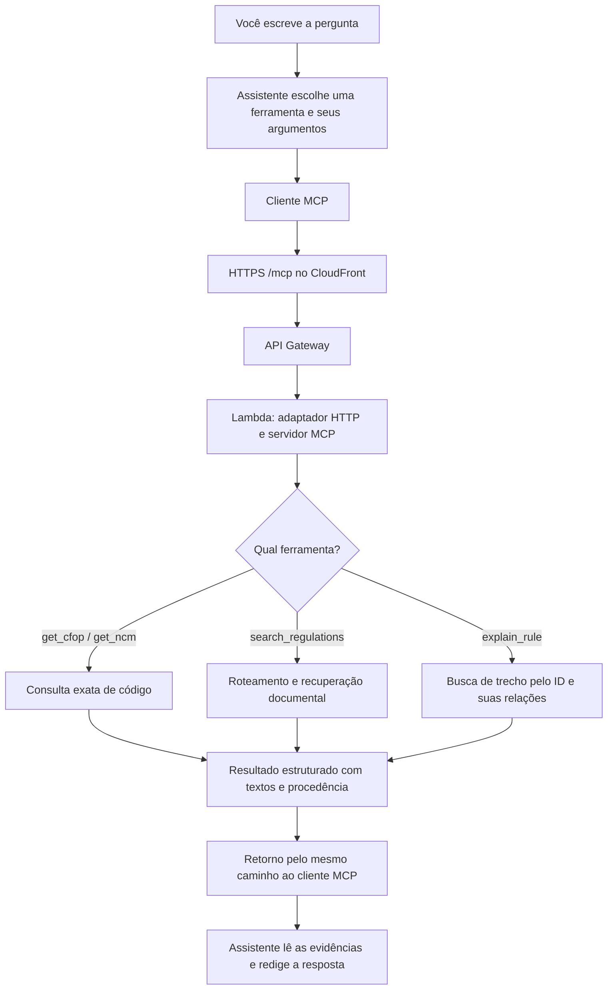

# Como funciona o Fiscal RAG Lab, passo a passo

Este guia explica a implementação existente em 14/11/2026. Foi escrito para quem ainda não conhece busca vetorial. Os trechos de código vêm deste repositório; quando há simplificação, ela está indicada. Os exemplos de textos curtos são fictícios e não expressam regras fiscais.

**A ideia central:** o assistente pede uma pesquisa por meio do MCP; o servidor encontra registros ou trechos do acervo; o assistente recebe esses textos com suas fontes e escreve a resposta. A busca não produz um parecer tributário automaticamente.

**Uma particularidade importante deste projeto:** o endpoint publicado usa vetores calculados a partir das palavras por uma função de hash. Não há um modelo de embeddings treinado em significado no caminho publicado. Há também busca por palavras com BM25 e consulta direta de códigos. Portanto, nem toda chamada envolve busca vetorial.

## Roteiro de leitura

1. [As peças e suas funções](#1-as-peças-e-suas-funções)
2. [O caminho completo de uma chamada](#2-o-caminho-completo-de-uma-chamada)
3. [Como os documentos entram no acervo](#3-como-os-documentos-entram-no-acervo)
4. [Quando os índices são construídos](#4-quando-os-índices-são-construídos)
5. [O que é um vetor](#5-o-que-é-um-vetor)
6. [Como o projeto calcula os vetores](#6-como-o-projeto-calcula-os-vetores)
7. [Como comparar dois vetores](#7-como-comparar-dois-vetores)
8. [Como funciona a busca por palavras, BM25](#8-como-funciona-a-busca-por-palavras-bm25)
9. [Como as duas buscas são combinadas, RRF](#9-como-as-duas-buscas-são-combinadas-rrf)
10. [Filtros, fontes e resposta final](#10-filtros-fontes-e-resposta-final)
11. [Aplicando o fluxo à sua pergunta](#11-aplicando-o-fluxo-à-sua-pergunta)
12. [IVF, HNSW e embeddings aprendidos](#12-ivf-hnsw-e-embeddings-aprendidos)
13. [Experimento que você pode executar](#13-experimento-que-você-pode-executar)
14. [Mapa do código e limites atuais](#14-mapa-do-código-e-limites-atuais)

## 1. As peças e suas funções

Imagine uma biblioteca: os documentos são os livros; os índices ajudam a encontrar páginas; o assistente lê as páginas encontradas para responder. O MCP define como pedir essa pesquisa e receber o resultado.

| Peça | O que faz no projeto |
|---|---|
| Assistente / LLM | Interpreta a pergunta, solicita ferramentas e redige a resposta a partir das evidências retornadas. LLM é o modelo de linguagem usado pelo aplicativo da conversa. |
| Cliente MCP | Envia as chamadas de ferramentas e recebe os resultados. Pode ser o cliente integrado ao aplicativo ou o cliente do projeto. |
| Servidor MCP | Expõe quatro ferramentas, valida os parâmetros e encaminha cada chamada para o serviço correspondente. |
| Corpus / acervo | Coleção de registros e trechos de documentos com fonte, edição, datas e identificadores. |
| Recuperador / retriever | Procura e ordena trechos do corpus. É implementado pela classe `HybridRetriever`. |
| Provedor de embeddings | Converte texto em uma lista de números. No endpoint atual, é `HashEmbeddingProvider`. |
| Índice vetorial | Guarda vetores ligados aos IDs dos trechos e procura os mais próximos de um vetor de consulta. |
| Índice BM25 | Guarda quais palavras aparecem em quais trechos e calcula uma pontuação lexical. |
| Repositório CFOP/NCM | Procura códigos completos e suas versões diretamente. |

**RAG** significa *Retrieval-Augmented Generation*: geração de texto apoiada por recuperação de informação. Neste projeto, a recuperação está no servidor; a geração da resposta está no assistente que chamou a ferramenta. O servidor MCP não chama uma LLM para escrever a resposta final.

**MCP** significa *Model Context Protocol*. Ele padroniza a comunicação das ferramentas. O algoritmo de busca continua sendo código da nossa aplicação. Neste repositório, MCP é um adaptador: as classes de busca não precisam conhecer ChatGPT, Codex ou AWS.

## 2. O caminho completo de uma chamada

### 2.1 Visão do endpoint publicado



O endereço é `https://d2kvl1uo6lcsgz.cloudfront.net/mcp`. O S3 serve os arquivos estáticos da página; quem executa a busca é a Lambda. Os documentos usados na pesquisa estão no `corpus.json` incluído no pacote da função. A consulta não baixa as páginas da Receita ou da SEFAZ em tempo real.

Fontes desta descrição: [adaptador Lambda](apps/mcp-server/src/lambda.ts), [empacotamento](scripts/build-lambda.ts) e [implantação AWS](deploy/aws/README.md). Esta tarefa de documentação não alterou a implantação.

### 2.2 O cliente envia o nome da ferramenta e os argumentos

Uma chamada de busca tem esta forma no SDK. O exemplo mostra uma consulta técnica, não uma conclusão fiscal:

```ts
const response = await client.callTool({
  name: 'search_regulations',
  arguments: {
    query: 'dobradiças metal',
    jurisdiction: 'MG',
    date: '2026-11-14',
    topK: 5,
    mode: 'hybrid'
  }
});
```

O cliente abre a conexão com `StreamableHTTPClientTransport`. O SDK cuida da negociação de protocolo e do transporte das mensagens. O servidor disponibiliza nomes, descrições e esquemas das ferramentas para o cliente. Nosso [cliente por código](scripts/query-rag.ts) usa:

```ts
await client.connect(new StreamableHTTPClientTransport(new URL(endpoint)));
```

Uma pergunta pode exigir várias chamadas. O servidor não recebe obrigatoriamente toda a conversa: recebe os argumentos enviados em cada chamada. Se o assistente deixar de incluir uma informação relevante na pesquisa, o recuperador não a deduz automaticamente da conversa.

### 2.3 O servidor encaminha a chamada para uma função TypeScript

Em [server.ts](apps/mcp-server/src/server.ts), o registro da ferramenta de busca é:

```ts
server.registerTool('search_regulations', {
  description: 'Busca documental com fonte, vigência e exceções. Não determina tratamento tributário.',
  inputSchema: searchInput,
  outputSchema: searchOutput,
  annotations: readOnlyAnnotations
}, input => structured(searchOutput, () => services.retriever.search(input)));
```

Leia de dentro para fora: `services.retriever.search(input)` faz a pesquisa; `structured(...)` valida o formato da saída; `registerTool(...)` torna essa operação acessível pelo MCP.

**É aí que “o MCP chama o RAG”: uma chamada de método dentro do mesmo processo Node.js.** Não há um segundo servidor chamado “RAG” sendo consultado por HTTP nesta implantação. O salto de rede é entre o cliente e o endpoint MCP; a recuperação usa as classes e os dados carregados pela Lambda.

Os [contratos](apps/mcp-server/src/contracts.ts) limitam, por exemplo, a consulta a 2.000 caracteres e `topK` a um inteiro entre 1 e 50. Zod valida estruturas e tipos; essa validação não comprova que uma conclusão fiscal esteja correta.

### 2.4 As quatro ferramentas têm caminhos diferentes

| Ferramenta | Caminho da chamada | Calcula vetor da consulta? |
|---|---|---|
| `get_cfop` | Normaliza o código e consulta suas versões no repositório. | Não. |
| `get_ncm` | Normaliza o código e consulta suas versões no repositório. | Não. |
| `search_regulations` | Identifica código completo ou executa pesquisa lexical, vetorial ou híbrida. | Somente na pesquisa textual em modo `vector` ou `hybrid`. |
| `explain_rule` | Busca um ID de evidência e os trechos relacionados já registrados. | Não. |

Apesar do nome, `explain_rule` não gera uma explicação com uma LLM: devolve texto documental e relações. A redação explicativa fica com o assistente.

## 3. Como os documentos entram no acervo

Há dois momentos diferentes: **preparar o acervo** e **consultar o acervo**. Baixar e processar documentos faz parte da preparação, executada por comandos de manutenção separados.

```text
Fonte oficial autorizada
  → download dos bytes e registro da procedência
  → snapshot local com checksum SHA-256
  → parser adequado ao formato
  → registros CFOP/NCM e fragmentos de documentos
  → corpus.json
  → carregamento e criação dos índices no servidor
```

O checksum é uma impressão digital dos bytes do arquivo. Ele permite verificar se o conteúdo mudou ou foi corrompido. Não certifica a interpretação jurídica do documento.

### 3.1 Parsear é transformar o formato em dados utilizáveis

O projeto tem caminhos específicos para tabela CFOP em XLSX, tabela NCM em JSON e documentos HTML. O parser extrai os campos ou o texto relevante. A existência de um download não garante que seu conteúdo já esteja pesquisável: alguns arquivos estão apenas arquivados, aguardando parsers.

Os registros CFOP/NCM ficam na lista `codes`. Eles também viram evidências textuais na lista `evidence`, com descrição e notas. Assim, o mesmo registro pode ser acessado por código exato ou aparecer em uma busca textual.

Em [build-corpus.ts](apps/ingestion-worker/src/build-corpus.ts), o texto dessas evidências é montado assim:

```ts
text: `${code.kind.toUpperCase()} ${code.code}: ${code.description}\n${code.notes ?? ''}`.trim()
```

### 3.2 Por que dividir documentos em fragmentos?

Uma norma pode ter centenas de páginas. Comparar a pergunta com um único vetor de todo o documento mistura muitos assuntos. Além disso, devolver o documento inteiro torna mais difícil localizar a passagem relevante.

O projeto divide o texto em unidades menores, chamadas *chunks* ou fragmentos. O [fragmentador legal](packages/retrieval/src/legal-chunker.ts) tenta reconhecer artigos, parágrafos, incisos e expressões de exceção. Unidades longas são divididas; o limite padrão é **1.600 caracteres**, não 1.600 tokens de uma LLM.

Fragmentos mantêm `parentId` e `relatedIds`, ligando, quando reconhecidos, um trecho ao artigo principal, a exceções ou às outras partes da mesma unidade. Isso ajuda a recuperar contexto. Essas ligações são heurísticas de texto, não uma compreensão jurídica completa.

### 3.3 O texto continua guardado junto com a sua identidade

Cada evidência tem, entre outros campos:

| Campo | Significado |
|---|---|
| `id`, `documentId` | Identificadores do fragmento e do documento. |
| `text` | O texto que será indexado e poderá ser devolvido ao assistente. |
| `article`, `parentId`, `relatedIds` | Estrutura e relações reconhecidas na extração. |
| `sourceUrl`, `authority` | Fonte oficial e órgão responsável. |
| `edition`, `fetchedAt`, `publishedAt` | Edição, momento da coleta e data de publicação, quando conhecida. |
| `validFrom`, `validTo` | Limites de vigência conhecidos; podem ser `null`. |
| `checksum` | Identificação dos bytes da fonte. |

A vetorização usa **`e.text`**. Os metadados permanecem separados para filtros e atribuição; não são todos convertidos em palavras dentro do vetor. A busca recupera o texto original pelo ID, em vez de tentar reconstruí-lo a partir dos números.

O [relatório de ingestão de 14/11/2026](docs/data/official-corpus.json) registra **33.496 evidências**, incluindo os textos dos **10.516 registros NCM** e **619 registros CFOP**. Não são 33.496 normas diferentes. A cobertura é parcial e inclui fontes nacionais, de SP e de MG.

## 4. Quando os índices são construídos

O `corpus.json` contém texto e metadados. Na inicialização, [runtime.ts](apps/mcp-server/src/runtime.ts) lê esse arquivo e monta os serviços. A composição usa:

```ts
const retriever = await HybridRetriever.create(
  corpus, codes, provider, new BruteForceIndex<string>()
);
```

Na configuração padrão publicada, `provider` é `HashEmbeddingProvider`, com **128 dimensões**. O índice vetorial é `BruteForceIndex`, que compara a consulta com todos os vetores.

Em [HybridRetriever.create](packages/retrieval/src/hybrid.ts), o código percorre os fragmentos em lotes de 64:

```ts
for (let start = 0; start < entries.length; start += 64) {
  const batch = entries.slice(start, start + 64);
  const encoded = await embeddings.embed(batch.map(e => e.text));
  validateEmbeddings(encoded, batch.length, embeddings.dimensions);
  batch.forEach((e, i) => {
    retriever.lexical.add(e.id, e.text, e.id);
    vectors.add(e.id, encoded[i], e.id);
  });
}
```

Cada fragmento entra em dois índices: um de palavras e um de vetores. Em ambos, o ID aponta de volta para a evidência completa.

Na Lambda, `handlerPromise` é guardado fora da função que atende cada requisição. Isso permite reaproveitar serviços e índices nas chamadas seguintes à **mesma instância**. Uma instância nova precisa carregar e indexar novamente. Instâncias diferentes não compartilham esse `Map` em memória.

Consequências práticas:

- A primeira chamada em uma instância nova inclui o custo de preparação.
- As chamadas seguintes normalmente calculam apenas o vetor da nova consulta, quando necessário.
- Mesmo que a primeira chamada seja `get_ncm`, o carregamento atual prepara todos os índices.
- A biblioteca tem serialização do índice exato, mas o runtime publicado não restaura um snapshot de vetores: ele os reconstrói a partir dos textos.
- Modificar o corpus local não atualiza a Lambda automaticamente. É necessário reconstruir e implantar o pacote.

## 5. O que é um vetor

Neste contexto, um vetor é simplesmente **uma lista de números em posições fixas**:

```text
[0, 1, 0, 2, 0, ...]
```

Uma lista com 128 números tem 128 dimensões. “Dimensão” significa posição na lista; não exige imaginar um desenho em 128 dimensões para usar o algoritmo.

Para começar, imagine um vocabulário minúsculo e uma posição exclusiva para cada palavra:

| Texto | dobradiça | metal | venda | madeira |
|---|---:|---:|---:|---:|
| Consulta: `dobradiça metal` | 1 | 1 | 0 | 0 |
| D1: `venda dobradiça metal` | 1 | 1 | 1 | 0 |
| D2: `venda madeira` | 0 | 0 | 1 | 1 |
| D3: `dobradiça metal metal` | 1 | 2 | 0 | 0 |

Os números contam ocorrências. D1 compartilha duas palavras com a consulta; D2 não compartilha nenhuma. Uma comparação numérica consegue detectar essa diferença.

Essa tabela é uma introdução. No código real não reservamos uma posição exclusiva para cada palavra: usamos uma função de hash para distribuir palavras em 128 posições. Isso economiza espaço, mas permite colisões.

## 6. Como o projeto calcula os vetores

O arquivo [hash-embedding.ts](packages/adapters/src/hash-embedding.ts) implementa quatro etapas.

### 6.1 Preparar as palavras

```ts
const tokens = text.normalize('NFD')
  .replace(/[\u0300-\u036f]/g, '')
  .toLowerCase()
  .match(/[\p{L}\p{N}]+/gu);
```

Para `Venda de DOBRADIÇAS, metal!`, isso produz:

```text
["venda", "de", "dobradicas", "metal"]
```

Nesse ponto, *token* significa um bloco de letras/números extraído pela expressão regular. Não é necessariamente o mesmo tipo de token usado para cobrança ou contexto de uma LLM.

O código remove acentos, coloca letras em minúsculas e separa por pontuação/espaços. Ele **não** reduz automaticamente plural para singular, não retira palavras como `de` e não reconhece sinônimos. `dobradica` e `dobradicas` continuam strings distintas. Um código pontuado também pode virar várias partes na busca textual; por isso há uma rota especial para códigos completos.

### 6.2 Escolher a posição de cada palavra

O trecho real é:

```ts
const vector = new Float32Array(this.dimensions);
for (const token of tokens) {
  let hash = 2166136261;
  for (const char of token) {
    hash = Math.imul(hash ^ char.codePointAt(0)!, 16777619) >>> 0;
  }
  vector[hash % this.dimensions] += 1;
}
```

`Float32Array(128)` cria 128 números inicialmente zerados, com 32 bits cada. A função baseada em FNV-1a transforma os caracteres de cada palavra em um inteiro. `% 128` calcula o resto da divisão, escolhendo uma posição entre 0 e 127. Cada ocorrência acrescenta 1 nessa posição.

Para as palavras do nosso exemplo, o código produz estas posições reais:

| Palavra normalizada | Posição no vetor de 128 dimensões |
|---|---:|
| `dobradica` | 12 |
| `venda` | 61 |
| `madeira` | 70 |
| `metal` | 92 |

Assim, `dobradiça metal metal` gera 1 na posição 12, 2 na posição 92 e zero nas demais, antes da normalização.

**Colisão:** duas palavras diferentes podem cair na mesma posição. Com muitas palavras e apenas 128 posições isso inevitavelmente acontece. Elas então contribuem para o mesmo número, mesmo sem relação de significado. Esse hash organiza características do texto; não é o checksum SHA-256 usado para conferir os arquivos oficiais.

### 6.3 Normalizar o tamanho do vetor

O código calcula a norma, ou comprimento numérico, e divide cada posição por ela:

```ts
const norm = Math.sqrt(vector.reduce((sum, n) => sum + n * n, 0));
return vector.map(n => n / norm);
```

Para as duas posições não zeradas de D3, `[1, 2]`:

```text
norma = √(1² + 2²) = √5 ≈ 2,236068
vetor normalizado = [1/√5, 2/√5] ≈ [0,447214, 0,894427]
```

Na consulta `[1, 1]`, a norma é `√2`, e as posições não zeradas tornam-se `[0,707107, 0,707107]`. Os zeros permanecem zeros.

A normalização coloca os vetores em escala comparável. Um texto que apenas repetisse todas as suas palavras duas vezes manteria a mesma direção. Isso não torna diferentes textos semanticamente equivalentes. O cosseno implementado também calcula as normas durante a comparação, mesmo recebendo vetores já normalizados.

### 6.4 O que esse vetor consegue representar

Ele representa a distribuição de palavras em posições compartilhadas. Não representa explicitamente “operação interestadual”, “contribuinte” ou “exceção legal” como conceitos interpretados.

A ordem das palavras é perdida: `venda metal` e `metal venda` produzem o mesmo vetor. Colisões podem criar similaridade artificial. Não há treinamento, aprendizado com as conversas ou consulta a uma LLM dentro de `HashEmbeddingProvider`.

## 7. Como comparar dois vetores

O índice usa **similaridade de cosseno**. Ela compara a direção dos vetores:

```text
cosseno(a, b) = soma(a[i] × b[i]) / (norma(a) × norma(b))
```

O numerador é chamado de *produto escalar*. Multiplicamos números na mesma posição e somamos. A divisão pelas normas evita favorecer um vetor só porque todos os seus números são maiores.

Trecho de [similarity.ts](packages/vector-core/src/similarity.ts), omitindo as validações:

```ts
let dot = 0;
let aa = 0;
let bb = 0;
for (let i = 0; i < a.length; i++) {
  dot += a[i] * b[i];
  aa += a[i] * a[i];
  bb += b[i] * b[i];
}
return dot / (Math.sqrt(aa) * Math.sqrt(bb));
```

Com os vetores de contagem não negativos deste provedor, o resultado fica entre 0 e 1, salvo efeitos minúsculos de arredondamento. Em vetores gerais com valores negativos, o cosseno pode chegar a -1.

- **1:** mesma direção numérica; isso não prova que os textos sejam iguais.
- **0:** nenhuma sobreposição nas posições utilizadas, neste exemplo de contagens.
- **0,95:** forte proximidade nessa representação; não significa 95% de chance de a resposta estar correta.

### 7.1 Calculando o nosso exemplo

Podemos usar as contagens antes de normalizar, pois a fórmula divide pelas normas:

```text
Consulta × D1: (1×1 + 1×1) / (√2 × √3) ≈ 0,816497
Consulta × D2: 0 / (√2 × √2) = 0
Consulta × D3: (1×1 + 1×2) / (√2 × √5) ≈ 0,948683
```

Ranking vetorial: **D3, D1, D2**. A camada de recuperação remove pontuações iguais a zero, então D2 não chega à resposta nesse exemplo.

### 7.2 Como o servidor encontra os maiores cossenos

O [índice exato](packages/vector-core/src/brute-force-index.ts) percorre todos os vetores:

```ts
for (const [id, entry] of this.vectors.entries()) {
  hits.push({
    id,
    payload: entry.payload,
    score: cosineSimilarity(query, entry.vector)
  });
}
return hits.sort((a, b) => b.score - a.score || a.id.localeCompare(b.id))
  .slice(0, k);
```

Isso é *brute force*, ou busca exaustiva: calcular todos os resultados e ordenar. “Exato” significa encontrar os melhores resultados para **essa métrica e esses vetores**, não encontrar necessariamente o documento juridicamente correto.

Com 33.496 vetores de 128 dimensões, cada consulta vetorial compara **4.287.488 pares de coordenadas**, além de validações, somas, filtros e ordenação. O custo de comparação cresce com `N × d`; a ordenação completa acrescenta `N log N`, onde `N` é a quantidade de vetores e `d` é a dimensão.

Só os números dos vetores ocupam `33.496 × 128 × 4 = 17.149.952 bytes`, cerca de **16,36 MiB**. Isso é uma conta do armazenamento numérico, não uma medição da memória total do processo: textos, cópias, índices BM25, objetos e bibliotecas também ocupam memória.

## 8. Como funciona a busca por palavras, BM25

BM25 responde a uma pergunta diferente: **quais trechos contêm as palavras da consulta, e com que relevância lexical?**

O [índice BM25](packages/retrieval/src/bm25.ts) usa a mesma forma de separar e normalizar palavras, mas mantém as palavras como chaves, sem reuni-las nas 128 posições do vetor. Uma estrutura simplificada do nosso exemplo seria:

```text
dobradica → D1: 1 ocorrência; D3: 1 ocorrência
metal     → D1: 1 ocorrência; D3: 2 ocorrências
venda     → D1: 1 ocorrência; D2: 1 ocorrência
madeira   → D2: 1 ocorrência
```

Isso se chama **índice invertido**: parte da palavra para chegar aos documentos. A busca percorre as listas das palavras presentes na consulta; não precisa ler cada texto inteiro a cada chamada.

### 8.1 O que entra na pontuação

O BM25 combina:

- **Frequência no trecho (`tf`):** uma palavra aparecer mais vezes ajuda, mas o ganho diminui a cada repetição.
- **Raridade no acervo (`idf`):** palavras presentes em poucos documentos recebem mais peso.
- **Comprimento do trecho:** ajuda a compensar a maior oportunidade que um texto longo tem de conter palavras.

No código, `k1 = 1.2` controla a saturação da frequência e `b = 0.75` controla o ajuste por comprimento. A contribuição de cada palavra usa:

```ts
const idf = Math.log(1 + (n - posting.size + 0.5) / (posting.size + 0.5));
const score = idf * tf * (this.k1 + 1)
  / (tf + this.k1 * (1 - this.b + this.b * length / averageLength));
```

`n` é o total de trechos; `posting.size`, quantos contêm aquela palavra; `length`, o comprimento do trecho em tokens; `averageLength`, o comprimento médio. As contribuições das palavras são somadas. A consulta usa um conjunto de termos: repetir a mesma palavra na consulta não multiplica sua contribuição no BM25 desta implementação.

No nosso corpus fictício de apenas três textos, o código calcula:

| Trecho | Pontuação BM25 | Posição |
|---|---:|---:|
| D3 | 1,071445 | 1 |
| D1 | 0,894277 | 2 |
| D2 | Sem termo correspondente | Não retornado |

Se o corpus mudar, a raridade e o comprimento médio podem mudar; portanto, o BM25 do mesmo trecho também pode mudar. Ele não é uma probabilidade e não usa a mesma escala do cosseno.

## 9. Como as duas buscas são combinadas, RRF

Em `search_regulations`, o modo padrão é `hybrid`. As opções são:

| `mode` | O que é feito para uma consulta textual |
|---|---|
| `lexical` | Pesquisa BM25, sem calcular vetor da consulta. |
| `vector` | Calcula o vetor da consulta e pesquisa por cosseno. |
| `hybrid` | Executa as duas pesquisas e combina as posições. |

O modo não muda a preparação inicial: o runtime atual constrói ambos os índices. Também não impede o roteamento de um código completo para consulta exata.

Não somamos diretamente `0,948683` de cosseno a `1,071445` de BM25. As escalas são diferentes. Usamos **Reciprocal Rank Fusion**, ou RRF, que soma contribuições baseadas nas posições de cada resultado:

```text
pontuação RRF = soma de 1 / (60 + posição) em cada lista onde o trecho aparece
```

As posições começam em 1. Um trecho que aparece em primeiro lugar nas duas buscas recebe:

```text
1/(60+1) + 1/(60+1) ≈ 0,032787
```

Se aparece em segundo nas duas:

```text
1/(60+2) + 1/(60+2) ≈ 0,032258
```

O código central de [reciprocalRankFusion](packages/retrieval/src/hybrid.ts) é:

```ts
score: (previous?.score ?? 0) + 1 / (constant + rank)
```

A constante padrão é 60. Ela não é a quantidade de resultados, nem a dimensão do vetor. O algoritmo dá o mesmo peso às duas listas. Neste exemplo, D3 fica em primeiro e D1 em segundo também após a fusão.

**Limite do modo híbrido atual:** os dois sinais continuam ligados às palavras, porque o vetor é um hash lexical. Combinar os rankings não introduz compreensão semântica aprendida. Não há um modelo adicional lendo pergunta e documentos para reordená-los.

## 10. Filtros, fontes e resposta final

### 10.1 Primeiro: a consulta é um código completo?

`routeQuery` reconhece entradas inteiras como `NCM 8302.10.00`, `83021000` ou `CFOP 6102`. Nesses casos, até `search_regulations` retorna um `lookup` de código, sem pesquisa vetorial.

Uma frase como `qual regra para o NCM 8302.10.00 nesta venda?` segue a busca textual: a expressão de roteamento exige que a consulta inteira corresponda ao padrão. Não há extração automática de todos os códigos de uma pergunta longa.

O repositório remove pontos, forma uma chave como `ncm:83021000` e procura versões em um `Map`. O resultado pode ser `found`, `not-found`, `ambiguous` ou `insufficient-evidence`. A ausência de registro no corpus não prova inexistência legal.

### 10.2 Depois: filtrar jurisdição e vigência na busca textual

Para consultas textuais, a sequência atual é:

```text
Obter candidatos BM25 e/ou vetoriais
  → remover candidatos incompatíveis com jurisdição ou vigência conhecida
  → remover scores não positivos
  → fundir os rankings, se o modo for híbrido
  → selecionar até topK resultados principais
  → anexar relações disponíveis e permitidas pelos filtros
```

`jurisdiction: 'MG'` permite documentos de **MG e BR**. `'SP'` permite **SP e BR**. `'BR'` permite apenas BR. Sem esse parâmetro, todas as jurisdições do corpus podem participar. A ferramenta aceita uma jurisdição por chamada; pesquisar origem e destino pode exigir duas chamadas.

A data elimina intervalos comprovadamente incompatíveis. A função [temporalStatus](packages/corpus/src/evidence.ts) usa:

- `outside-validity`: data anterior ao início conhecido ou posterior ao fim conhecido; o resultado é excluído.
- `valid`: início e fim conhecidos, com a data dentro do intervalo.
- `unknown`: algum limite é desconhecido, sem incompatibilidade comprovada; o resultado permanece com essa ressalva.

Essa é a política conservadora do código. `validTo: null` não vira uma garantia de validade eterna. E `fetchedAt` informa quando coletamos o arquivo, não quando cada dispositivo entrou em vigor.

Na implementação atual, as buscas pedem tantos candidatos quanto o tamanho do índice, para aplicar filtros antes de cortar em `topK`. Assim, `topK: 5` limita os resultados principais devolvidos, mas **não** limita a pesquisa a cinco comparações. Em corpus grande, esse caminho tem custo; particionar índices por filtros é uma melhoria pendente.

### 10.3 O retorno contém evidências, não apenas uma pontuação

A saída de `search_regulations` contém:

| Campo | Como ler |
|---|---|
| `route` | Caminho realmente usado: `cfop`, `ncm`, `lexical`, `vector` ou `hybrid`. |
| `evidence` | Trechos principais, com `text`, `id`, procedência, `score` e `temporalStatus`. |
| `relatedEvidence` | Dentro de cada resultado principal, relações disponíveis como artigo pai e fragmentos irmãos. Podem aumentar o volume além de `topK`. |
| `lookup` | Resultado de código quando houve roteamento exato; nos demais casos, `null`. |
| `missingContext` | Avisos de contexto que precisa ser conferido. |
| `warning` | Limites do uso da evidência. |

`missingContext` é uma lista programada, não uma análise inteligente da conversa. Por exemplo, a busca sempre sinaliza `regime` e `operation`, pois não recebe esses campos estruturados. Mencionar Simples Nacional no texto influencia correspondência de palavras, mas não aciona um motor de regras do regime.

O servidor devolve tanto `structuredContent` quanto uma representação JSON em conteúdo de texto. O cliente do projeto valida a saída pelo esquema. O assistente lê os trechos e pode chamar `explain_rule` para recuperar um ID específico e suas relações. Essa ferramenta mantém a procedência, mas não acrescenta o campo `temporalStatus` calculado às evidências como a busca faz.

### 10.4 Onde a LLM entra novamente

O cliente fornece os resultados ao assistente, que redige a resposta com fontes e ressalvas. Não é necessário mandar todos os 33.496 fragmentos à LLM: somente os resultados selecionados e suas relações retornam nessa chamada.

A política do projeto exige evidências apenas do RAG, sem completar lacunas fiscais com web ou memória do modelo. Isso é diferente de apagar o conhecimento prévio da LLM: o servidor MCP não controla todas as ferramentas do aplicativo nem comprova que cada frase gerada decorre das evidências. Os limites desse controle estão em [RAG exclusivo](docs/rag-only.md).

## 11. Aplicando o fluxo à sua pergunta

Seu caso envolve revenda, origem SP, destino MG, NCM informado, finalidade de uso próprio, contribuinte, Simples Nacional e uma data. A identificação da resposta exige relacionar esses elementos; proximidade entre palavras sozinha não resolve isso.

Um fluxo de investigação documental pode ser:

1. **Consultar o NCM fornecido** com `get_ncm`. Isso recupera o registro, sem decidir sozinho a classificação do produto.
2. **Pesquisar trechos sobre a operação**, dividindo a pergunta em consultas mais focadas. Pesquisas de SP e MG também incluem fontes nacionais.
3. **Consultar exatamente um CFOP candidato que apareceu nas evidências**, usando `get_cfop`, para ler descrição, notas e versão.
4. **Abrir evidências relevantes pelo ID**, com `explain_rule`, e ler as relações disponíveis.
5. **Conferir cobertura, contexto e datas** antes de formular uma conclusão condicional ou apontar evidência insuficiente.

Isso não é uma sequência automática de cinco passos implementada no servidor. O cliente/assistente conduz as chamadas. O [cenário inicial](docs/initial-scenario.md) registra consultas e limites observados, e `npm run eval:initial` verifica seu contrato documental; ele não certifica a aplicação tributária nem a qualidade de qualquer resposta de uma LLM.

O caso inicial também mostrou uma limitação concreta: buscas amplas de revenda colocaram textos de devolução e transferência acima do candidato pertinente. Eles compartilham muitas palavras. O primeiro resultado é o primeiro do ranking, não uma decisão fiscal.

## 12. IVF, HNSW e embeddings aprendidos

São duas decisões separadas: **como representar o texto** e **como procurar entre as representações**.

### 12.1 O índice decide como procurar

| Índice existente no repositório | Ideia | Situação no endpoint |
|---|---|---|
| `BruteForceIndex` | Compara com todos os vetores e ordena. | Ativo. |
| `IvfIndex` | Agrupa vetores e pesquisa alguns grupos mais próximos. | Implementado para experimentos; não selecionado no runtime publicado. |
| `HnswIndex` | Liga vetores em um grafo e navega por vizinhos em camadas. | Implementado para experimentos; não selecionado no runtime publicado. |

**IVF:** K-Means cria grupos e um centro representativo de cada grupo. `nlist` define a quantidade de grupos; `nprobe`, quantos grupos consultar. Pesquisar menos grupos pode economizar comparações e deixar resultados relevantes de fora. A implementação está em [ivf-index.ts](packages/vector-core/src/ivf-index.ts).

**HNSW:** vetores viram nós ligados a outros vetores. Camadas superiores ajudam a se aproximar de uma região; a camada inferior explora candidatos. `m` controla conexões, `efConstruction` o esforço na construção e `efSearch` o esforço de pesquisa. Mais exploração pode melhorar recuperação e aumentar custo. A implementação está em [hnsw-index.ts](packages/vector-core/src/hnsw-index.ts).

Esses índices aproximados podem perder vizinhos que a busca exata encontraria. Eles aceleram a procura por uma métrica; não corrigem uma representação inadequada do texto. Os [benchmarks](docs/benchmarks/README.md) são experimentos do laboratório, não uma promessa de desempenho tributário em produção.

Há ainda um detalhe de integração: o recuperador atual pede até `size` candidatos antes de filtrar. Trocar apenas `BruteForceIndex` por HNSW pode eliminar boa parte da economia esperada, pois a implementação HNSW explora pelo menos `max(k, efSearch)`. Essa mudança exigiria revisar a estratégia de candidatos/filtros e medir cobertura.

### 12.2 O provedor decide como representar o texto

Um modelo de embeddings aprendido transforma textos usando parâmetros treinados. Ele pode aproximar expressões relacionadas mesmo sem palavras idênticas, dependendo do modelo e dos dados. Isso não transforma similaridade em prova de uma regra fiscal.

O projeto tem a porta `EmbeddingProvider` e um [adaptador Ollama](packages/adapters/src/ollama-embedding.ts). Ele envia textos a `/api/embed` e valida os vetores recebidos. O ponto de entrada local, [main.ts](apps/mcp-server/src/main.ts), aceita configuração de provedor, modelo, dimensões e URL.

**O endpoint Lambda atual continua no hash local:** `lambda.ts` chama `loadServices` com a configuração padrão; não lê aquelas opções de embeddings de `main.ts`. Ativar outro provedor na AWS exige alterar e testar essa composição e prover o serviço correspondente.

Para usar um novo modelo, documentos e consultas precisam ser representados pelo mesmo modelo/configuração. Mesma quantidade de dimensões não basta para tornar dois espaços compatíveis. É necessário recalcular os vetores do corpus, avaliar o ranking e planejar custo e disponibilidade. Isso não foi ativado por este guia.

Embeddings também são diferentes do experimento LoRA: um representa texto para pesquisa; o outro alteraria parâmetros de um modelo treinado. O treinamento LoRA permanece em aberto e não participa das consultas atuais.

## 13. Experimento que você pode executar

Este exemplo usa os algoritmos reais com três textos fictícios. Não consulta a internet, o MCP ou fontes fiscais, e não modifica o corpus.

Na raiz do projeto, execute `npm run build`. Se as dependências ainda não estiverem instaladas, execute `npm ci` primeiro. Depois, cole o bloco inteiro abaixo no PowerShell, ainda na raiz do projeto. O trecho entre `@'` e `'@` é JavaScript passado ao Node:

```powershell
@'
import { HashEmbeddingProvider } from './dist/packages/adapters/src/hash-embedding.js';
import { Bm25Index } from './dist/packages/retrieval/src/bm25.js';
import { BruteForceIndex } from './dist/packages/vector-core/src/brute-force-index.js';
import { reciprocalRankFusion } from './dist/packages/retrieval/src/hybrid.js';

const docs = [
  { id: 'D1', text: 'venda dobradiça metal' },
  { id: 'D2', text: 'venda madeira' },
  { id: 'D3', text: 'dobradiça metal metal' }
];
const query = 'dobradiça metal';
const provider = new HashEmbeddingProvider(128);
const encoded = await provider.embed(docs.map(d => d.text));
const [queryVector] = await provider.embed([query]);
const lexical = new Bm25Index();
const vectors = new BruteForceIndex();

docs.forEach((d, i) => {
  lexical.add(d.id, d.text, d.id);
  vectors.add(d.id, encoded[i], d.id);
});

const bm25 = lexical.search(query, docs.length);
const cosine = vectors.search(queryVector, docs.length).filter(h => h.score > 0);
const hybrid = reciprocalRankFusion([bm25, cosine], 3);
const compact = hits => hits.map(h => ({ id: h.id, score: Number(h.score.toFixed(6)) }));

console.log('Posições não zeradas da consulta:');
console.table(Array.from(queryVector).flatMap((value, position) =>
  value ? [{ position, value: Number(value.toFixed(6)) }] : []));
console.log('BM25'); console.table(compact(bm25));
console.log('Cosseno'); console.table(compact(cosine));
console.log('RRF'); console.table(compact(hybrid));
'@ | node --input-type=module
```

Resultado numérico verificado com o código deste projeto, arredondado a seis casas:

| Resultado | D3 | D1 |
|---|---:|---:|
| Cosseno | 0,948683 | 0,816497 |
| BM25 | 1,071445 | 0,894277 |
| RRF | 0,032787 | 0,032258 |

O vetor da consulta tem `0,707107` nas posições 12 e 92. D2 não é retornado após o filtro de score positivo. São resultados de um exemplo de três textos; não são métricas do corpus oficial.

Experimente mudar a consulta para `dobradiças metal` e observe o efeito do plural. Depois mude a ordem das palavras e veja que a representação permanece igual. Isso torna visível tanto o que o algoritmo faz quanto o que ele deixa de representar.

Para acompanhar uma chamada MCP real, o [cliente do projeto](scripts/query-rag.ts) lê um plano JSON com esta estrutura:

```json
{
  "calls": [
    {
      "name": "search_regulations",
      "arguments": {
        "query": "dobradiças metal",
        "date": "2026-11-14",
        "jurisdiction": "MG",
        "topK": 3,
        "mode": "lexical"
      }
    }
  ]
}
```

Salve, por exemplo, em `.data/plano-rag.json` e, após o build, execute:

```powershell
node dist/scripts/query-rag.js .data/plano-rag.json .data/resultado-rag.json
```

Esse segundo exemplo acessa o endpoint remoto do RAG e grava a resposta em `.data`, fora do Git. O cliente está restrito às quatro ferramentas. Seu uso nesta conversa já foi autorizado; ele não busca as URLs oficiais devolvidas e não permite fallback externo.

## 14. Mapa do código e limites atuais

Uma ordem útil para ler o código é:

| Ordem | Arquivo | O que procurar |
|---|---|---|
| 1 | [Cliente MCP](scripts/query-rag.ts) | `connect` e `callTool`. |
| 2 | [Servidor MCP](apps/mcp-server/src/server.ts) | `registerTool` e encaminhamento aos serviços. |
| 3 | [Composição](apps/mcp-server/src/runtime.ts) | Escolha do provedor e do índice. |
| 4 | [Recuperação](packages/retrieval/src/hybrid.ts) | Construção, roteamento, busca, filtros e RRF. |
| 5 | [Vetor por hash](packages/adapters/src/hash-embedding.ts) | Palavras, posições, contagens e normalização. |
| 6 | [Cosseno](packages/vector-core/src/similarity.ts) e [índice exato](packages/vector-core/src/brute-force-index.ts) | Comparação e ordenação dos vetores. |
| 7 | [BM25](packages/retrieval/src/bm25.ts) | Listas invertidas e pontuação lexical. |
| 8 | [Consulta de códigos](packages/fiscal-domain/src/code-repository.ts) | Normalização, versões e lookup por chave. |
| 9 | [Modelo de evidência](packages/corpus/src/evidence.ts) | Procedência e política de vigência. |
| 10 | [Montagem do corpus](apps/ingestion-worker/src/build-corpus.ts) | Snapshots, parsers e evidências textuais. |

Limites que afetam a interpretação dos resultados hoje:

- A busca vetorial publicada usa hash lexical, com colisões e sem semântica aprendida.
- O ranking mede correspondência; não verifica automaticamente regras, exceções ou tratamento tributário de uma operação.
- O acervo é parcial; alguns documentos baixados ainda não foram indexados.
- Vigência desconhecida e redações históricas exigem revisão. Coleta recente não resolve esses pontos.
- A inicialização reconstrói os índices em memória, e a pesquisa vetorial publicada examina todos os vetores.
- A atualização das fontes é uma operação separada, sem aprendizado automático a partir das perguntas.

As melhorias estão registradas em [TODO.md](TODO.md), a cobertura em [ingestão oficial](docs/official-ingestion.md) e a política de respostas em [RAG exclusivo](docs/rag-only.md).
