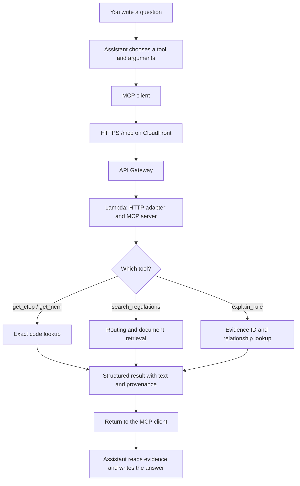

# How Fiscal RAG Lab works, step by step

This guide explains the implementation as of 2026-11-14 for readers new to vector search. Code excerpts come from this repository; simplifications are identified. Short example texts are fictional and do not express tax rules.

**The central idea:** the assistant requests research through MCP; the server finds records or excerpts in the corpus; the assistant receives those texts with their sources and writes the answer. Search does not automatically produce tax advice.

**A specific feature of this project:** the published endpoint calculates vectors from words through a hash function, without a model trained on meaning. It also supports BM25 word search and direct code lookup. Not every call involves vector search.

## Reading guide

1. [The parts and their roles](#1-the-parts-and-their-roles)
2. [The complete path of a call](#2-the-complete-path-of-a-call)
3. [How documents enter the corpus](#3-how-documents-enter-the-corpus)
4. [When indexes are built](#4-when-indexes-are-built)
5. [What a vector is](#5-what-a-vector-is)
6. [How the project calculates vectors](#6-how-the-project-calculates-vectors)
7. [How to compare two vectors](#7-how-to-compare-two-vectors)
8. [How BM25 word search works](#8-how-bm25-word-search-works)
9. [How RRF combines both searches](#9-how-rrf-combines-both-searches)
10. [Filters, sources and the final answer](#10-filters-sources-and-the-final-answer)
11. [Applying the workflow to the example question](#11-applying-the-workflow-to-the-example-question)
12. [IVF, HNSW and learned embeddings](#12-ivf-hnsw-and-learned-embeddings)
13. [An experiment you can run](#13-an-experiment-you-can-run)
14. [Code map and current limitations](#14-code-map-and-current-limitations)

## 1. The parts and their roles

Imagine a library: documents are books; indexes help find pages; the assistant reads the retrieved pages to answer. MCP defines how to request that research and receive results.

| Part | Role in the project |
|---|---|
| Assistant / LLM | Interprets the question, requests tools and writes the answer from returned evidence. The LLM is the conversation application's language model. |
| MCP client | Sends tool calls and receives results, either integrated into an application or provided by this project. |
| MCP server | Exposes four tools, validates parameters and forwards each call to its service. |
| Corpus | Records and document excerpts with sources, editions, dates and identifiers. |
| Retriever | Finds and ranks corpus excerpts; implemented by `HybridRetriever`. |
| Embedding provider | Converts text to numbers. The current endpoint uses `HashEmbeddingProvider`. |
| Vector index | Stores vectors linked to excerpt IDs and finds those closest to a query vector. |
| BM25 index | Records which words appear in which excerpts and computes lexical scores. |
| CFOP/NCM repository | Looks up complete codes and their editions directly. |

**RAG** means *Retrieval-Augmented Generation*: text generation supported by information retrieval. Retrieval runs on this server; generation happens in the assistant that called the tool. The MCP server does not call an LLM to write the final answer.

**MCP** means *Model Context Protocol*. It standardizes tool communication. The search algorithm remains application code. MCP is an adapter: search classes need not know ChatGPT, Codex or AWS.

## 2. The complete path of a call

### 2.1 The published endpoint



Address: `https://d2kvl1uo6lcsgz.cloudfront.net/mcp`. S3 serves static files; Lambda executes search. Research documents live in `corpus.json` inside the function package. Queries do not download Receita Federal or SEFAZ pages in real time.

Sources: [Lambda adapter](apps/mcp-server/src/lambda.ts), [packaging](scripts/build-lambda.ts) and [AWS deployment](deploy/aws/README.md). This documentation task does not change deployment.

### 2.2 The client sends a tool name and arguments

This SDK example is a technical query, not a tax conclusion:

```ts
const response = await client.callTool({
  name: 'search_regulations',
  arguments: {
    query: 'hinges metal',
    jurisdiction: 'MG',
    date: '2026-11-14',
    topK: 5,
    mode: 'hybrid'
  }
});
```

`StreamableHTTPClientTransport` opens the connection. The SDK handles negotiation and message transport; the server publishes tool names, descriptions and schemas. The [project client](scripts/query-rag.ts) uses:

```ts
await client.connect(new StreamableHTTPClientTransport(new URL(endpoint)));
```

A question may require several calls. The server receives each call's arguments, not necessarily the entire conversation. It does not infer information omitted by the assistant. The official corpus is Portuguese; English lexical queries may need explicit source-language keywords.

### 2.3 The server forwards the call to TypeScript

Search registration in [server.ts](apps/mcp-server/src/server.ts):

```ts
server.registerTool('search_regulations', {
  description: 'Search documents with source, validity and exceptions. Does not determine tax treatment.',
  inputSchema: toMcpSchema(searchInput),
  outputSchema: toMcpSchema(searchOutput),
  annotations: readOnlyAnnotations
}, input => structured(searchOutput, () => services.retriever.search(input)));
```

Read from the inside out: `services.retriever.search(input)` searches; `structured(...)` validates output; `registerTool(...)` exposes the operation through MCP.

**This is where “MCP calls RAG”: a method call inside the same Node.js process.** There is no second “RAG” server queried over HTTP. The network hop is between client and MCP endpoint; retrieval uses Lambda's loaded classes and data.

[Contracts](apps/mcp-server/src/contracts.ts) limit queries to 2,000 characters and `topK` to an integer from 1 to 50. They use `ObjectContract` and `Field`:

```ts
const searchInput = new ObjectContract({
  query: Field.text({ trim: true, minLength: 1, maxLength: 2000 }),
  topK: Field.integer({ min: 1, max: 50 }).optional()
});
```

Other fields are omitted here for clarity. `toMcpSchema` adapts contracts to the SDK; the [validation class](packages/validation/README.md) encapsulates Zod. Type/structure validation does not establish tax correctness. This refactor preserves MCP message shapes.

### 2.4 The four tools take different paths

| Tool | Call path | Computes a query vector? |
|---|---|---|
| `get_cfop` | Normalize a code and look up its editions. | No. |
| `get_ncm` | Normalize a code and look up its editions. | No. |
| `search_regulations` | Detect a complete code or run lexical, vector or hybrid search. | Only text queries in `vector` or `hybrid` mode. |
| `explain_rule` | Look up an evidence ID and its recorded relationships. | No. |

`explain_rule` does not generate an LLM explanation: it returns document text and relationships. The assistant writes the explanation.

## 3. How documents enter the corpus

**Preparing** and **querying** the corpus are separate stages. Downloads and processing use separate maintenance commands.

```text
Authorized official source
  → download bytes and record provenance
  → local snapshot with SHA-256 checksum
  → format-specific parser
  → CFOP/NCM records and document chunks
  → corpus.json
  → server loading and index construction
```

A checksum fingerprints file bytes to detect changes or corruption. It does not certify legal interpretation.

### 3.1 Parsing makes a format usable

Specific paths handle CFOP XLSX tables, NCM JSON tables and HTML documents. Parsers extract relevant fields or text. A downloaded file is not necessarily searchable: some files are only archived, awaiting parsers.

CFOP/NCM records live in `codes` and also become textual `evidence`, with descriptions and notes. A record can therefore be retrieved by exact code or text search. [build-corpus.ts](apps/ingestion-worker/src/build-corpus.ts) assembles that text as follows:

```ts
text: `${code.kind.toUpperCase()} ${code.code}: ${code.description}\n${code.notes ?? ''}`.trim()
```

### 3.2 Why split documents into chunks?

A rule may span hundreds of pages. One vector for the whole document mixes topics, and returning the entire document makes the relevant passage hard to locate.

The [legal chunker](packages/retrieval/src/legal-chunker.ts) recognizes articles, paragraphs, numbered provisions and exception phrases where possible. Long units are split; the default limit is **1,600 characters**, not LLM tokens.

`parentId` and `relatedIds` link excerpts to main articles, exceptions or parts of the same unit where recognized. These links retrieve context through text heuristics, not complete legal understanding.

### 3.3 Text stays with its identity

| Field | Meaning |
|---|---|
| `id`, `documentId` | Chunk and document identifiers. |
| `text` | Text indexed and potentially returned to the assistant. |
| `article`, `parentId`, `relatedIds` | Recognized structure and relationships. |
| `sourceUrl`, `authority` | Official source and responsible authority. |
| `edition`, `fetchedAt`, `publishedAt` | Edition, collection time and known publication date. |
| `validFrom`, `validTo` | Known validity boundaries; may be `null`. |
| `checksum` | Identification of source bytes. |

Vectorization uses **`e.text`**. Metadata stays separate for filtering and attribution rather than all becoming vector words. Search retrieves original text by ID instead of reconstructing it from numbers.

The [2026-11-14 report](docs/data/official-corpus.json) records **33,496 evidence items**, including text for **10,516 NCM records** and **619 CFOP records**. These are not 33,496 separate regulations. Coverage includes selected national, SP and MG sources.

## 4. When indexes are built

At startup, [runtime.ts](apps/mcp-server/src/runtime.ts) reads text and metadata from `corpus.json` and constructs services:

```ts
const retriever = await HybridRetriever.create(
  corpus, codes, provider, new BruteForceIndex<string>()
);
```

The published default is `HashEmbeddingProvider` with **128 dimensions** and `BruteForceIndex`, comparing queries against every vector. [HybridRetriever.create](packages/retrieval/src/hybrid.ts) processes chunks in batches of 64:

```ts
for (let start = 0; start < entries.length; start += 64) {
  const batch = entries.slice(start, start + 64);
  const encoded = await embeddings.embed(batch.map(e => e.text));
  validateEmbeddings(encoded, batch.length, embeddings.dimensions);
  batch.forEach((e, i) => {
    retriever.lexical.add(e.id, e.text, e.id);
    vectors.add(e.id, encoded[i], e.id);
  });
}
```

Each chunk enters word and vector indexes, with IDs pointing to complete evidence.

Lambda stores `handlerPromise` outside its per-request function, reusing services for later calls to the **same instance**. New instances load and index again; separate instances do not share an in-memory `Map`.

- The first call includes preparation cost.
- Later calls normally compute only the new query vector when needed.
- Even an initial `get_ncm` call currently prepares every index.
- Exact-index serialization exists, but the published runtime rebuilds vectors rather than restoring a snapshot.
- Local corpus edits require rebuilding and deploying the package.

## 5. What a vector is

A vector is **a list of numbers at fixed positions**:

```text
[0, 1, 0, 2, 0, ...]
```

A list of 128 numbers has 128 dimensions. A dimension is a position in the list; no 128-dimensional visualization is needed.

Start with a tiny vocabulary and one position per word:

| Text | hinge | metal | sale | wood |
|---|---:|---:|---:|---:|
| Query: `hinge metal` | 1 | 1 | 0 | 0 |
| D1: `sale hinge metal` | 1 | 1 | 1 | 0 |
| D2: `sale wood` | 0 | 0 | 1 | 1 |
| D3: `hinge metal metal` | 1 | 2 | 0 | 0 |

Numbers count occurrences. D1 shares two words with the query; D2 shares none. Numerical comparison detects this difference.

Actual code does not reserve a position per word: it hashes words into 128 positions, saving space but permitting collisions.

## 6. How the project calculates vectors

[hash-embedding.ts](packages/adapters/src/hash-embedding.ts) implements four stages.

### 6.1 Prepare words

```ts
const tokens = text.normalize('NFD')
  .replace(/[\u0300-\u036f]/g, '')
  .toLowerCase()
  .match(/[\p{L}\p{N}]+/gu);
```

`Sale of HINGES, metal!` produces:

```text
["sale", "of", "hinges", "metal"]
```

Here a *token* is a letter/number block extracted by a regular expression, not necessarily an LLM billing/context token.

The code removes accents, lowercases and splits punctuation/spaces. It does **not** singularize words, remove words such as `of` or recognize synonyms. `hinge` and `hinges` remain different. Punctuated codes may split into parts, which is why complete codes have a special route.

### 6.2 Choose each word's position

```ts
const vector = new Float32Array(this.dimensions);
for (const token of tokens) {
  let hash = 2166136261;
  for (const char of token) {
    hash = Math.imul(hash ^ char.codePointAt(0)!, 16777619) >>> 0;
  }
  vector[hash % this.dimensions] += 1;
}
```

`Float32Array(128)` creates 128 zeros, each using 32 bits. An FNV-1a-based function converts characters into an integer. `% 128` selects a position from 0 to 127; each occurrence adds 1.

Actual positions for this English example:

| Word | Position |
|---|---:|
| `hinge` | 12 |
| `sale` | 62 |
| `wood` | 104 |
| `metal` | 92 |

`hinge metal metal` produces 1 at position 12, 2 at 92 and zeros elsewhere before normalization.

**Collision:** different words can occupy the same position. With many words and only 128 positions, collisions are inevitable and can combine unrelated meanings. This text-feature hash is not the SHA-256 checksum used to verify official files.

### 6.3 Normalize vector length

```ts
const norm = Math.sqrt(vector.reduce((sum, n) => sum + n * n, 0));
return vector.map(n => n / norm);
```

For D3's nonzero coordinates, `[1, 2]`:

```text
norm = √(1² + 2²) = √5 ≈ 2.236068
normalized vector = [1/√5, 2/√5] ≈ [0.447214, 0.894427]
```

The query `[1, 1]` has norm `√2`, yielding `[0.707107, 0.707107]`. Zeros remain zero.

Normalization makes scales comparable. Repeating every word twice retains direction; it does not make different texts semantically equivalent. The cosine implementation also calculates norms during comparison, even for normalized inputs.

### 6.4 What this vector represents

It represents word distribution across shared positions, not explicit concepts such as interstate transactions, taxpayer status or legal exceptions.

Word order is lost: `sale metal` and `metal sale` have the same vector. Collisions can create artificial similarity. `HashEmbeddingProvider` has no training, learning from conversations or LLM calls.

## 7. How to compare two vectors

The index uses **cosine similarity**, comparing direction:

```text
cosine(a, b) = sum(a[i] × b[i]) / (norm(a) × norm(b))
```

The numerator is the *dot product*: multiply corresponding coordinates and add. Dividing by norms avoids favoring vectors merely because their numbers are larger.

[similarity.ts](packages/vector-core/src/similarity.ts), omitting validation:

```ts
let dot = 0;
let aa = 0;
let bb = 0;
for (let i = 0; i < a.length; i++) {
  dot += a[i] * b[i];
  aa += a[i] * a[i];
  bb += b[i] * b[i];
}
return dot / (Math.sqrt(aa) * Math.sqrt(bb));
```

For nonnegative count vectors the result is between 0 and 1, apart from tiny rounding effects. General vectors with negative values can reach -1.

- **1:** same numerical direction, not proof of identical text.
- **0:** no overlap in occupied coordinates in this count example.
- **0.95:** strong proximity in this representation, not 95% confidence in an answer.

### 7.1 Calculate the example

Counts can be used before normalization because the formula divides by norms:

```text
Query × D1: (1×1 + 1×1) / (√2 × √3) ≈ 0.816497
Query × D2: 0 / (√2 × √2) = 0
Query × D3: (1×1 + 1×2) / (√2 × √5) ≈ 0.948683
```

Ranking: **D3, D1, D2**. Retrieval removes zero scores, excluding D2 from this response.

### 7.2 Find the largest cosines

The [exact index](packages/vector-core/src/brute-force-index.ts) visits every vector:

```ts
for (const [id, entry] of this.vectors.entries()) {
  hits.push({
    id,
    payload: entry.payload,
    score: cosineSimilarity(query, entry.vector)
  });
}
return hits.sort((a, b) => b.score - a.score || a.id.localeCompare(b.id))
  .slice(0, k);
```

This is *brute force*: calculate every result and sort. “Exact” means best for **this metric and these vectors**, not necessarily the legally correct document.

With 33,496 vectors of 128 dimensions, each query compares **4,287,488 coordinate pairs**, plus validation, addition, filtering and sorting. Comparison grows with `N × d`; full sorting adds `N log N`, for vector count `N` and dimension `d`.

Numbers alone occupy `33,496 × 128 × 4 = 17,149,952 bytes`, about **16.36 MiB**. This is not total process memory: text, copies, BM25 indexes, objects and libraries also consume memory.

## 8. How BM25 word search works

BM25 asks: **which excerpts contain the query words, and how lexically relevant are they?**

The [BM25 index](packages/retrieval/src/bm25.ts) uses the same word splitting and normalization but retains words as keys rather than combining them into 128 vector positions:

```text
hinge → D1: 1 occurrence; D3: 1 occurrence
metal → D1: 1 occurrence; D3: 2 occurrences
sale  → D1: 1 occurrence; D2: 1 occurrence
wood  → D2: 1 occurrence
```

This is an **inverted index**: start from a word to reach documents. Search visits the query words' lists without rereading every complete text.

### 8.1 Score components

- **Frequency (`tf`):** more occurrences help, with diminishing gains.
- **Rarity (`idf`):** words present in fewer documents receive more weight.
- **Length:** compensates for longer texts having more opportunities to contain words.

`k1 = 1.2` controls frequency saturation; `b = 0.75` controls length adjustment. Each word contributes:

```ts
const idf = Math.log(1 + (n - posting.size + 0.5) / (posting.size + 0.5));
const score = idf * tf * (this.k1 + 1)
  / (tf + this.k1 * (1 - this.b + this.b * length / averageLength));
```

`n` is excerpt count; `posting.size` counts those containing the word; `length` is excerpt length in tokens; `averageLength` is the mean length. Contributions are added. Queries use a term set: repeating a query word does not multiply its contribution.

For the fictional three-text corpus:

| Excerpt | BM25 score | Rank |
|---|---:|---:|
| D3 | 1.071445 | 1 |
| D1 | 0.894277 | 2 |
| D2 | No matching term | Not returned |

Changing the corpus can change rarity, mean length and a given excerpt's score. BM25 is neither a probability nor on the same scale as cosine.

## 9. How RRF combines both searches

`search_regulations` defaults to `hybrid`:

| `mode` | Text-query behavior |
|---|---|
| `lexical` | BM25 without computing a query vector. |
| `vector` | Compute a query vector and search by cosine. |
| `hybrid` | Run both and combine their ranks. |

The mode does not change startup, which builds both indexes, or prevent complete-code routing to exact lookup.

Cosine `0.948683` and BM25 `1.071445` are not added directly because their scales differ. **Reciprocal Rank Fusion (RRF)** sums rank-based contributions:

```text
RRF score = sum of 1 / (60 + rank) across lists containing the excerpt
```

Ranks start at 1. First in both lists:

```text
1/(60+1) + 1/(60+1) ≈ 0.032787
```

Second in both:

```text
1/(60+2) + 1/(60+2) ≈ 0.032258
```

Core [reciprocalRankFusion](packages/retrieval/src/hybrid.ts) code:

```ts
score: (previous?.score ?? 0) + 1 / (constant + rank)
```

The default constant 60 is neither result count nor vector dimension. Both lists receive equal weight. D3 remains first and D1 second.

**Current limitation:** both signals are word-based because vectors use lexical hashing. Fusion does not add learned semantic understanding. No additional model reads questions/documents to rerank them.

## 10. Filters, sources and the final answer

### 10.1 Is the query a complete code?

`routeQuery` recognizes entire inputs such as `NCM 8302.10.00`, `83021000` or `CFOP 6102`. Even `search_regulations` then returns code `lookup` without vector search.

`which rule applies to NCM 8302.10.00 in this sale?` follows text search: the entire query must match the routing expression. Codes are not automatically extracted from long questions.

The repository removes dots, builds a key such as `ncm:83021000` and looks up editions in a `Map`. Results are `found`, `not-found`, `ambiguous` or `insufficient-evidence`. Missing records do not establish legal nonexistence.

### 10.2 Filter jurisdiction and validity

```text
Obtain BM25 and/or vector candidates
  → remove incompatible jurisdiction/known-validity candidates
  → remove nonpositive scores
  → fuse rankings in hybrid mode
  → select up to topK main results
  → attach available relationships allowed by filters
```

`jurisdiction: 'MG'` permits **MG and BR**, `'SP'` permits **SP and BR**, and `'BR'` permits only BR. Without it, all corpus jurisdictions may participate. Each call accepts one jurisdiction, so origin/destination research may require two calls.

[temporalStatus](packages/corpus/src/evidence.ts) uses:

- `outside-validity`: before a known start or after a known end; exclude.
- `valid`: known start/end with the date inside the interval.
- `unknown`: a boundary is unknown without demonstrated incompatibility; retain with qualification.

`validTo: null` does not guarantee eternal validity. `fetchedAt` records collection time, not each provision's effective date.

Current searches request up to the index size before filtering and cutting to `topK`. `topK: 5` limits returned main results, **not** comparisons. This is costly for large corpora; index partitioning remains pending.

### 10.3 Results contain evidence, not just scores

| Field | Meaning |
|---|---|
| `route` | Actual path: `cfop`, `ncm`, `lexical`, `vector` or `hybrid`. |
| `evidence` | Main excerpts with `text`, `id`, provenance, `score` and `temporalStatus`. |
| `relatedEvidence` | Available parent/sibling links inside each main result; may increase volume beyond `topK`. |
| `lookup` | Code result under exact routing; otherwise `null`. |
| `missingContext` | Context requiring review. |
| `warning` | Limits on evidence use. |

`missingContext` is a programmed list, not conversation analysis. Search always flags `regime` and `operation` because they are not structured inputs. Mentioning Simples Nacional changes word matching but does not invoke a regime rule engine.

The server returns both `structuredContent` and text JSON. The project client validates output against its schema. The assistant may use `explain_rule` for a specific ID and relationships. That tool preserves provenance but does not add search's calculated `temporalStatus` field.

### 10.4 Where the LLM returns

The client supplies results to the assistant, which writes an answer with sources and qualifications. Only selected excerpts/relationships need to reach the LLM, not all 33,496 chunks.

Policy requires RAG-only evidence, without filling tax gaps from web search or model memory. It does not erase prior knowledge: MCP does not control every application tool or prove every generated sentence follows from evidence. See [RAG-only evidence](docs/rag-only.md).

## 11. Applying the workflow to the example question

The initial scenario includes resale, origin SP, destination MG, a supplied NCM, own use, taxpayer status, Simples Nacional and a date. Relating these elements requires more than word proximity.

1. **Look up the supplied NCM** with `get_ncm`, without independently deciding product classification.
2. **Search transaction excerpts** through focused queries. SP/MG searches include national sources.
3. **Look up an exact CFOP candidate found in evidence** with `get_cfop`, reading description, notes and edition.
4. **Open relevant evidence IDs** with `explain_rule` and read available relationships.
5. **Check coverage, context and dates** before a conditional conclusion or insufficient-evidence response.

This is not an automatic server workflow. The client/assistant directs calls. The [initial scenario](docs/initial-scenario.md) and `npm run eval:initial` document and check a retrieval contract, not tax applicability or LLM answer quality.

Broad resale queries ranked returns/transfers above the relevant candidate because of shared words. The top result is a ranking position, not a tax decision.

## 12. IVF, HNSW and learned embeddings

These are separate decisions: **how to represent text** and **how to search among representations**.

### 12.1 The index determines how to search

| Index | Idea | Endpoint status |
|---|---|---|
| `BruteForceIndex` | Compare every vector and sort. | Active. |
| `IvfIndex` | Group vectors and probe nearby groups. | Experiments only. |
| `HnswIndex` | Navigate vectors through layered neighbor graphs. | Experiments only. |

**IVF:** K-Means builds groups and representative centers. `nlist` sets group count; `nprobe` sets how many to query. Fewer probes save comparisons but may miss relevant results. See [ivf-index.ts](packages/vector-core/src/ivf-index.ts).

**HNSW:** vectors become connected nodes. Upper layers approach a region; the bottom explores candidates. `m` controls connections, `efConstruction` construction effort and `efSearch` search effort. More exploration may improve recall and increase cost. See [hnsw-index.ts](packages/vector-core/src/hnsw-index.ts).

Approximate indexes may miss exact-search neighbors. They accelerate a metric, not fix an unsuitable representation. [Benchmarks](docs/benchmarks/README.md) are experiments, not promises of production tax performance.

The retriever requests up to `size` candidates before filtering. Replacing only `BruteForceIndex` with HNSW may remove expected savings because HNSW explores at least `max(k, efSearch)`. Candidate/filter strategy and coverage need reevaluation.

### 12.2 The provider determines how to represent text

Learned embeddings use trained parameters and may connect related expressions without identical words, depending on model/data. Similarity still does not establish a tax rule.

The `EmbeddingProvider` port and [Ollama adapter](packages/adapters/src/ollama-embedding.ts) support `/api/embed` and validate returned vectors. Local [main.ts](apps/mcp-server/src/main.ts) accepts provider, model, dimensions and URL.

**Lambda still uses local hashing:** `lambda.ts` calls `loadServices` with defaults and does not read `main.ts` embedding options. Another provider requires composition changes, testing and provisioning its service.

Documents and queries must use the same model/configuration. Equal dimensions do not make spaces compatible. Recompute corpus vectors, evaluate ranking and plan cost/availability. This guide does not activate another model.

Embeddings represent text for search; LoRA would change a trained model's parameters. LoRA remains pending and does not participate in current queries.

## 13. An experiment you can run

This uses actual algorithms with fictional texts, without internet/MCP/fiscal sources or corpus changes. Run `npm ci` if needed, then `npm run build` from the project root. Create `.data` if necessary and save this as `.data/vector-example.mjs`:

```js
import { HashEmbeddingProvider } from '../dist/packages/adapters/src/hash-embedding.js';
import { Bm25Index } from '../dist/packages/retrieval/src/bm25.js';
import { BruteForceIndex } from '../dist/packages/vector-core/src/brute-force-index.js';
import { reciprocalRankFusion } from '../dist/packages/retrieval/src/hybrid.js';

const docs = [
  { id: 'D1', text: 'sale hinge metal' },
  { id: 'D2', text: 'sale wood' },
  { id: 'D3', text: 'hinge metal metal' }
];
const query = 'hinge metal';
const provider = new HashEmbeddingProvider(128);
const encoded = await provider.embed(docs.map(d => d.text));
const [queryVector] = await provider.embed([query]);
const lexical = new Bm25Index();
const vectors = new BruteForceIndex();

docs.forEach((d, i) => {
  lexical.add(d.id, d.text, d.id);
  vectors.add(d.id, encoded[i], d.id);
});

const bm25 = lexical.search(query, docs.length);
const cosine = vectors.search(queryVector, docs.length).filter(h => h.score > 0);
const hybrid = reciprocalRankFusion([bm25, cosine], 3);
const compact = hits => hits.map(h => ({ id: h.id, score: Number(h.score.toFixed(6)) }));

console.log('Nonzero query coordinates:');
console.table(Array.from(queryVector).flatMap((value, position) =>
  value ? [{ position, value: Number(value.toFixed(6)) }] : []));
console.log('BM25'); console.table(compact(bm25));
console.log('Cosine'); console.table(compact(cosine));
console.log('RRF'); console.table(compact(hybrid));
```

Run from the project root:

```sh
node .data/vector-example.mjs
```

Results verified against project code, rounded to six decimals:

| Result | D3 | D1 |
|---|---:|---:|
| Cosine | 0.948683 | 0.816497 |
| BM25 | 1.071445 | 0.894277 |
| RRF | 0.032787 | 0.032258 |

The query has `0.707107` at positions 12 and 92. Positive-score filtering removes D2. These are toy results, not official-corpus metrics.

Change the query to `hinges metal` to observe the plural's effect. Reorder words to observe identical representations. This exposes both captured and omitted information.

For a real MCP call, the [project client](scripts/query-rag.ts) reads a JSON plan:

```json
{
  "calls": [
    {
      "name": "search_regulations",
      "arguments": {
        "query": "hinges metal",
        "date": "2026-11-14",
        "jurisdiction": "MG",
        "topK": 3,
        "mode": "lexical"
      }
    }
  ]
}
```

Save it as `.data/rag-plan.json` and run after building:

```sh
node dist/scripts/query-rag.js .data/rag-plan.json .data/rag-result.json
```

This accesses the remote RAG and saves its response outside Git. The client is restricted to four tools, does not fetch returned URLs and permits no external fallback. The official corpus is Portuguese; use source-language keywords where necessary for lexical matching.

## 14. Code map and current limitations

| Order | File | Look for |
|---|---|---|
| 1 | [MCP client](scripts/query-rag.ts) | `connect` and `callTool`. |
| 2 | [MCP server](apps/mcp-server/src/server.ts) | `registerTool` and service dispatch. |
| 3 | [Composition](apps/mcp-server/src/runtime.ts) | Provider and index selection. |
| 4 | [Retrieval](packages/retrieval/src/hybrid.ts) | Construction, routing, filters and RRF. |
| 5 | [Hash vectors](packages/adapters/src/hash-embedding.ts) | Words, positions, counts and normalization. |
| 6 | [Cosine](packages/vector-core/src/similarity.ts) and [exact index](packages/vector-core/src/brute-force-index.ts) | Vector comparison and sorting. |
| 7 | [BM25](packages/retrieval/src/bm25.ts) | Inverted lists and lexical scoring. |
| 8 | [Code lookup](packages/fiscal-domain/src/code-repository.ts) | Normalization, editions and key lookup. |
| 9 | [Evidence](packages/corpus/src/evidence.ts) | Provenance and validity policy. |
| 10 | [Corpus assembly](apps/ingestion-worker/src/build-corpus.ts) | Snapshots, parsers and textual evidence. |

Current limitations:

- Published vectors use lexical hashing, with collisions and no learned semantics.
- Ranking measures matching, not automatic verification of rules/exceptions or transaction tax treatment.
- The corpus is partial; some downloads are not indexed.
- Unknown validity/historical wording require review; recent collection does not resolve them.
- Startup rebuilds indexes, and vector queries examine every vector.
- Source updates are separate maintenance, not automatic learning from questions.

See [TODO.md](TODO.md), [official ingestion](docs/official-ingestion.md) and [RAG-only evidence](docs/rag-only.md) for improvements, coverage and answer policy.
