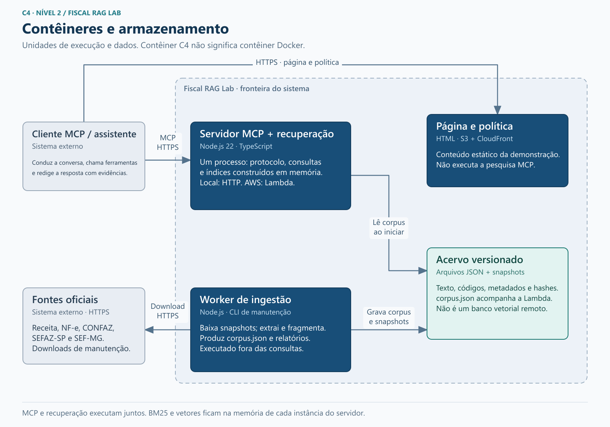

# Fiscal RAG Lab

Laboratório de pesquisa fiscal brasileira com **RAG, algoritmos próprios de busca e ferramentas MCP somente leitura**. O projeto transforma documentos oficiais e tabelas CFOP/NCM em evidências pesquisáveis, preservando fonte, edição, datas e relações entre trechos.

O objetivo é estudar e tornar inspecionável o caminho inteiro: baixar uma fonte, extrair seu conteúdo, construir índices, recuperar evidências e entregá-las a um assistente. A aplicação implementa a recuperação; a LLM do cliente redige a resposta a partir dos resultados. O servidor não contém uma LLM geradora nem um motor completo de decisão tributária.

**Estado documentado em 15/11/2026:** servidor MCP, ingestão, busca híbrida, índices exato/IVF/HNSW, contratos encapsulados e avaliações implementados. Há uma [demonstração HTTPS na AWS](https://d2kvl1uo6lcsgz.cloudfront.net), com corpus oficial carregado em 14/11/2026. O endpoint usa hash lexical de 128 dimensões e índice vetorial exato; embeddings aprendidos, IVF/HNSW no endpoint e treinamento LoRA não estão ativos. Revisão fiscal humana e teste completo do plugin em ChatGPT Work permanecem pendentes.

> É um projeto educacional de recuperação de evidências. Similaridade textual e código encontrado não comprovam enquadramento tributário. O projeto não emite NF-e nem calcula automaticamente todos os tributos de uma operação.

## Navegação

- [O que o projeto entrega](#o-que-o-projeto-entrega)
- [Tecnologias e responsabilidades](#tecnologias-e-responsabilidades)
- [Como os dados percorrem o sistema](#como-os-dados-percorrem-o-sistema)
- [Arquitetura C4 em quatro níveis](#arquitetura-c4-em-quatro-níveis)
- [Decisões arquiteturais — ADRs](#decisões-arquiteturais--adrs)
- [Ferramentas MCP](#ferramentas-mcp)
- [Corpus e procedência](#corpus-e-procedência)
- [Executar localmente](#executar-localmente)
- [Testes e avaliações](#testes-e-avaliações)
- [Implantação AWS e plugin](#implantação-aws-e-plugin)
- [Organização do repositório](#organização-do-repositório)
- [Limites e próximos passos](#limites-e-próximos-passos)

Para uma explicação didática de vetores, cosseno, BM25 e RRF, com contas e exemplos executáveis, leia o [README-RAG](README-RAG.md). Este README apresenta o projeto e relaciona as partes às decisões que as sustentam.

## O que o projeto entrega

| Capacidade | Implementação e alcance |
|---|---|
| Ingestão verificável | Downloads oficiais, snapshots por SHA-256, metadados de coleta e parsers de formatos específicos. |
| Consulta exata CFOP/NCM | Códigos completos normalizados, versões preservadas e retorno explícito de ausência, ambiguidade ou evidência insuficiente. |
| Fragmentação documental | Separação de unidades legais, com vínculos de artigos, exceções e partes de um mesmo trecho quando reconhecidos. |
| Busca lexical | BM25 próprio, com índice invertido de palavras. |
| Busca vetorial | Cosseno, busca exaustiva, K-Means/IVF e HNSW implementados no projeto. |
| Busca híbrida | Roteamento de códigos completos, recuperação textual e fusão dos rankings por Reciprocal Rank Fusion — RRF. |
| Filtragem e atribuição | Jurisdição, intervalos conhecidos de vigência, fontes e evidências relacionadas. Limites desconhecidos continuam explícitos. |
| Integração com assistentes | Quatro ferramentas MCP de leitura, com entradas e saídas estruturadas. |
| Avaliação reproduzível | Fixtures, testes numéricos, integração HTTP, datasets fixos e resultados com condições de execução. |

A escolha de implementar os índices, em vez de delegar a busca a um banco vetorial pronto, é parte do objetivo educacional: [ADR-0002](docs/adr/0002-manual-vector-index.md). Bibliotecas continuam sendo usadas para transporte, parsing e validação, com fronteiras explícitas.

## Tecnologias e responsabilidades

Versões declaradas no [package.json](package.json); a resolução completa está fixada no [package-lock.json](package-lock.json). A tabela descreve o uso neste repositório, não uma recomendação de versões mais recentes.

| Tecnologia | Versão / configuração | Onde e por quê |
|---|---|---|
| TypeScript | 5.8.3; modo `strict`; módulos ESM/NodeNext | Código de aplicação, contratos e portas tipadas. [ADR-0001](docs/adr/0001-modular-monolith.md). |
| Node.js | 22+ para desenvolvimento; Node 22 na Lambda | Runtime HTTP, CLIs, APIs de arquivos/criptografia e testes. |
| SDK MCP oficial | `server` e `client` 2.4.0; adaptador `node` 2.1.2 | Negociação e transporte Streamable HTTP, sem implementar o protocolo manualmente. [ADR-0008](docs/adr/0008-mcp-runtime.md). |
| Classes de validação próprias | `Schema<T>`, `ObjectContract`, `Field` | API legível para contratos, tipos inferidos e erros próprios. [ADR-0011](docs/adr/0011-validation-facade.md). |
| Zod | 4.6.7, encapsulado | Motor interno de validação e JSON Schema. Um adaptador converte nossos contratos para Standard Schema; consumidores não importam Zod. [Guia](packages/validation/README.md). |
| ExcelJS | 4.4.0 | Leitura da planilha CFOP no worker. O parser fiscal valida o esquema e recusa fórmulas. [ADR-0006](docs/adr/0006-parsing-and-runtime.md). |
| Cheerio | 1.1.2 | Extração HTML com seletores específicos de fontes oficiais. [ADR-0010](docs/adr/0010-official-html-ingestion.md). |
| iconv-lite | 0.7.0 | Decodificação de páginas, incluindo Windows-1252. [ADR-0010](docs/adr/0010-official-html-ingestion.md). |
| JSON, SHA-256 e estruturas em memória | APIs nativas de Node.js; `Map`, `Float32Array` | Snapshots, corpus, procedência e índices locais. Não há banco vetorial gerenciado na implantação atual. [ADR-0004](docs/adr/0004-versioned-legal-corpus.md). |
| Embedding por hash | `lexical-fnv1a-v1`, 128 dimensões | Controle determinístico de palavras usado pelo endpoint; não é um modelo semântico aprendido. [ADR-0007](docs/adr/0007-embedding-adapters.md). |
| Ollama | Adaptador opcional; modelo não selecionado para a implantação | Integração HTTP por `EmbeddingProvider`, disponível para experimentos com embeddings aprendidos. [ADR-0007](docs/adr/0007-embedding-adapters.md). |
| esbuild | 0.28.2; ferramenta de desenvolvimento | Empacota o servidor em `index.mjs` para Lambda. [ADR-0009](docs/adr/0009-aws-demo.md). |
| Sharp | 0.35.5; ferramenta de desenvolvimento | Renderiza assets e diagramas SVG em PNG. Não participa da pesquisa fiscal. |
| `node:test` e `node:assert` | Integrados ao Node.js | Testes unitários, contratos MCP e validação da inferência TypeScript. |
| GitHub Actions | Workflow versionado | Instalação reproduzível, testes, fronteiras de arquitetura, build Lambda e auditoria de dependências. [CI](.github/workflows/ci.yml). |
| AWS | S3, CloudFront, API Gateway HTTP API, Lambda e CloudWatch Logs | Página estática, HTTPS, execução do MCP e logs operacionais. Infraestrutura em CloudFormation. [ADR-0009](docs/adr/0009-aws-demo.md). |
| Modelo C4 | JSON versionado, exportação Structurizr DSL, SVG e PNG | Documentação de contexto, contêineres, componentes e um recorte de código. [Fontes e geração](docs/c4/README.md). |

### Algoritmos implementados no laboratório

| Algoritmo | Papel | Uso atual |
|---|---|---|
| Cosseno + busca exaustiva | Compara a consulta com todos os vetores; referência exata para a métrica. | Índice vetorial do endpoint. |
| BM25 | Combina frequência, raridade de palavras e comprimento dos trechos. | Busca lexical do endpoint. |
| RRF | Combina posições dos resultados de buscas distintas, sem somar escalas incompatíveis. | Modo híbrido padrão. |
| K-Means esférico + IVF | Agrupa vetores e consulta uma parte dos grupos; troca cobertura por menos comparações. | Experimentos e benchmark. |
| HNSW | Organiza vetores em um grafo de vizinhos com camadas. | Experimentos e benchmark. |

Trocar o índice não muda automaticamente a qualidade da representação textual. Um índice aproximado sobre vetores lexicais continua pesquisando vetores lexicais. Os detalhes estão no [guia de RAG](README-RAG.md) e nos [resultados dos índices](docs/benchmarks/README.md).

## Como os dados percorrem o sistema

1. **Manutenção do acervo:** o worker baixa edições oficiais autorizadas, guarda bytes e metadados, confere hashes e aplica o parser adequado. O conteúdo vira registros CFOP/NCM e fragmentos com procedência.
2. **Construção do corpus:** os registros e trechos são reunidos em `corpus.json`. Arquivos baixados sem parser ficam arquivados, sem se tornarem evidência pesquisável.
3. **Inicialização do servidor:** `loadServices` lê o corpus, cria repositórios em memória, calcula os vetores dos fragmentos e monta os índices BM25 e vetorial.
4. **Chamada MCP:** o cliente envia uma ferramenta e seus argumentos. O adaptador valida a entrada e chama os serviços no mesmo processo Node.js.
5. **Recuperação:** códigos completos seguem consulta exata. Perguntas textuais usam BM25, cosseno ou ambos; filtros conhecidos são aplicados antes do corte final dos resultados.
6. **Resposta documental:** o servidor retorna trechos, IDs, URLs, versões, datas e avisos. O assistente usa esse material para redigir a resposta e apontar lacunas.

A ingestão é separada da consulta. O endpoint não acessa páginas oficiais para completar uma pergunta em tempo real. A política de respostas está em [RAG exclusivo](docs/rag-only.md), e o tratamento da evidência está no [ADR-0004](docs/adr/0004-versioned-legal-corpus.md).

Na Lambda, os serviços são reaproveitados enquanto a mesma instância permanece ativa. Instâncias novas reconstroem seus índices. O corpus acompanha o pacote da função; alterar um arquivo local não atualiza a implantação automaticamente.

## Arquitetura C4 em quatro níveis

O projeto é um **monólito modular com portas e adaptadores**: MCP/HTTP e provedores são fronteiras externas; domínio, corpus e recuperação trabalham com interfaces próprias. O worker de ingestão é uma CLI separada. A justificativa está no [ADR-0001](docs/adr/0001-modular-monolith.md), complementada pelo [ADR-0003](docs/adr/0003-mcp-boundary.md).

Os PNGs abaixo são versionados e podem ser abertos em tamanho completo. O [modelo compartilhado](docs/c4/model.json) gera imagens e a [exportação Structurizr DSL](docs/c4/workspace.dsl), evitando manter descrições independentes para cada formato. A posição visual das caixas está no modelo; o código de renderização está em [render-c4.ts](scripts/render-c4.ts).

### Nível 1 — Contexto

Mostra quem usa o laboratório e os sistemas externos envolvidos. O assistente conduz a conversa; o Fiscal RAG Lab recupera evidências. O provedor Ollama aparece como integração opcional, fora do caminho da Lambda atual.

[](docs/c4/images/01-context.png)

### Nível 2 — Contêineres

Mostra unidades de execução e armazenamento. **Contêiner no C4 não significa Docker.** Servidor MCP e lógica de recuperação executam no mesmo processo; worker, acervo de arquivos e página estática têm responsabilidades distintas. CloudFront/API Gateway encaminham requisições ao servidor na implantação AWS.

[](docs/c4/images/02-containers.png)

### Nível 3 — Componentes

Abre o servidor em adaptador MCP, contratos, repositórios e recuperação. `HybridRetriever` combina BM25, provedor de vetores e índice exato, preservando a origem das evidências. Essas caixas representam módulos no mesmo processo, não microsserviços.

[](docs/c4/images/03-components.png)

### Nível 4 — Código

Recorte das classes dos índices vetoriais. `HybridRetriever` depende da porta `VectorIndex<T>`; `BruteForceIndex`, `IvfIndex` e `HnswIndex` implementam o mesmo contrato. O recorte torna visível a decisão do [ADR-0002](docs/adr/0002-manual-vector-index.md), sem tentar reproduzir todas as classes do repositório.

[](docs/c4/images/04-code.png)

Para regenerar todos os formatos com as dependências já instaladas:

```sh
npm run docs:c4
```

O comando funciona localmente, sem enviar o modelo a serviços de diagramas. A exportação DSL cobre os níveis 1–3; o nível 4 é o recorte de classes produzido pelo mesmo modelo em SVG/PNG. Instruções de edição e limites em [docs/c4/README.md](docs/c4/README.md).

## Decisões arquiteturais — ADRs

Um ADR registra o contexto, a escolha e suas consequências. Os links permitem conferir o fundamento de cada decisão; não equivalem a certificar a correção fiscal do sistema. Alguns textos preservam o estado inicial da decisão: evolução do corpus e refinamentos são descritos nos guias atuais.

| Decisão | Justificativa registrada |
|---|---|
| [0001 — Monólito modular e portas/adaptadores](docs/adr/0001-modular-monolith.md) | Reduzir complexidade operacional e manter busca/domínio independentes de transporte e fornecedor. |
| [0002 — Índices vetoriais próprios](docs/adr/0002-manual-vector-index.md) | Estudar algoritmos e medir aproximações contra uma referência exata. |
| [0003 — MCP como adaptador somente leitura](docs/adr/0003-mcp-boundary.md) | Compartilhar o backend entre clientes sem acoplar o domínio a um chatbot. |
| [0004 — Evidência legal versionada](docs/adr/0004-versioned-legal-corpus.md) | Preservar procedência, versões, estrutura e limites temporais. |
| [0005 — Fine-tuning após avaliação de recuperação](docs/adr/0005-fine-tuning-strategy.md) | Separar ganhos de busca, instruções e treinamento; evitar tratar memorização como atualização normativa. |
| [0006 — Bibliotecas de parsing nos adaptadores](docs/adr/0006-parsing-and-runtime.md) | Usar parser XLSX mantido sem delegar a lógica fiscal e os algoritmos de busca. |
| [0007 — Embeddings por uma porta própria](docs/adr/0007-embedding-adapters.md) | Trocar provedores sem alterar o recuperador e distinguir controle lexical de modelo aprendido. |
| [0008 — SDK MCP oficial](docs/adr/0008-mcp-runtime.md) | Delegar negociação e transporte ao SDK, com integração testável. |
| [0009 — Demonstração AWS](docs/adr/0009-aws-demo.md) | Usar S3/CloudFront para arquivos e API Gateway/Lambda para processamento. |
| [0010 — Extração de HTML oficial](docs/adr/0010-official-html-ingestion.md) | Seletores e encoding específicos, preservação de snapshots e exclusão explícita de conteúdo corrompido. |
| [0011 — Encapsulamento da validação](docs/adr/0011-validation-facade.md) | Classes próprias para contratos, Zod privado e integração por Standard Schema. |

## Ferramentas MCP

| Ferramenta | Entrada principal | O que retorna |
|---|---|---|
| `get_cfop` | Código completo; data opcional. | Registros exatos, versões, procedência, situação temporal e contexto faltante. |
| `get_ncm` | NCM completo; data opcional. | Registro e notas disponíveis; não classifica automaticamente um produto. |
| `search_regulations` | Texto, data, jurisdição, `topK` e modo de busca. | Evidências ranqueadas e relacionadas; códigos completos podem seguir a rota exata. |
| `explain_rule` | ID de evidência; data opcional. | Texto e relações existentes, sem geração de parecer pela ferramenta. |

Todas são de leitura. Os contratos rejeitam campos extras, limitam formatos e validam a saída. Cada resposta contém `structuredContent` e sua representação textual JSON. Veja os [contratos documentados](docs/mcp-contracts.md), as [declarações executáveis](apps/mcp-server/src/contracts.ts) e a [fachada de validação](packages/validation/README.md).

O modo padrão de busca textual é híbrido. `jurisdiction: 'MG'` permite MG e fontes BR; SP funciona da mesma forma. Datas incompatíveis com intervalos conhecidos são excluídas; limites desconhecidos permanecem indicados como `unknown`. O ranking não resolve automaticamente regime tributário, finalidade da compra ou aplicação de exceções.

## Corpus e procedência

A carga oficial registrada em **14/11/2026** priorizou fontes nacionais, depois São Paulo e Minas Gerais. Não há cobertura estadual de outras UFs neste recorte.

| Indicador do relatório de carga | Quantidade |
|---|---:|
| Entradas de fontes baixadas | 71, correspondentes a 70 URLs distintas |
| Entradas de fontes indexadas | 66 |
| Registros NCM completos | 10.516 |
| Registros CFOP | 619 |
| Evidências nacionais | 13.604 |
| Evidências de SP | 8.504 |
| Evidências de MG | 11.388 |
| Evidências totais | 33.496 |

Evidências são fragmentos e representações textuais de códigos, não necessariamente documentos independentes. As contagens e URLs estão no [relatório por fonte](docs/data/official-corpus.json); conteúdo, arquivos somente arquivados e exclusões estão no [guia de ingestão oficial](docs/official-ingestion.md).

Cada evidência conserva identificadores, texto, órgão, jurisdição, URL oficial, edição, instante de coleta, checksum e datas conhecidas. Datas desconhecidas são `null`; baixar uma consolidação hoje não prova a vigência de cada dispositivo em uma data solicitada.

Os bytes baixados e o corpus ficam em `.data/`, fora do Git. O repositório contém código, catálogo e relatórios necessários para reproduzir a carga. Documentos completos só podem ser redistribuídos após revisão dos termos aplicáveis. Essa separação segue o [ADR-0004](docs/adr/0004-versioned-legal-corpus.md).

## Executar localmente

Requisitos: **Node.js 22+ e npm**. Não é necessário instalar banco vetorial ou configurar uma LLM para executar a demonstração sintética.

### Instalar e verificar

Na raiz do repositório:

```sh
npm ci
npm test
npm run check:boundaries
```

### Iniciar com dados sintéticos

```sh
npm start -- --demo
```

O servidor atende em `http://127.0.0.1:3000/mcp`. Os dados de demonstração são fixtures sem valor fiscal. Em outro terminal, uma demonstração autônoma de chamadas pode ser executada com:

```sh
npm run demo:mcp
```

Esse comando abre seu próprio servidor temporário, chama as ferramentas com o cliente oficial, grava `.data/demo-transcript.json` e encerra. Ele não depende de uma conta de assistente nem constitui teste dentro do ChatGPT Work.

### Preparar e usar o corpus oficial

Ingestão é uma operação explícita de manutenção que acessa as fontes oficiais configuradas:

```sh
npm run ingest:official
npm start
```

Sem `--demo`, o caminho padrão local é `.data/corpus.json`; se o arquivo não existir, é preciso construir o corpus. Para reprocessar snapshots já existentes, use `npm run ingest:official -- --reuse`. Isso não representa uma nova consulta às fontes. Para reconstrução por manifesto, formatos e requisitos, consulte [ingestão oficial](docs/official-ingestion.md) e o [worker](apps/ingestion-worker/README.md).

### Configuração local

| Variável | Padrão / função |
|---|---|
| `MCP_CORPUS` | Caminho do corpus; normalmente `.data/corpus.json`. |
| `MCP_HOST` / `MCP_PORT` | `127.0.0.1` / `3000`. |
| `EMBEDDING_PROVIDER` | `hash`; `ollama` exige um runtime e modelo disponíveis. |
| `EMBEDDING_MODEL` | `lexical-fnv1a-v1` no controle hash. |
| `EMBEDDING_DIMENSIONS` | `128` no controle hash; deve corresponder ao modelo escolhido. |
| `OLLAMA_URL` | `http://127.0.0.1:11434` para o adaptador local opcional. |

Essas opções de embeddings são lidas pelo ponto de entrada local. A Lambda usa a composição padrão e não passa a utilizar Ollama apenas por receber essas variáveis. Modelos e dimensões não podem ser misturados entre documentos e consultas. Detalhes no [servidor](apps/mcp-server/README.md).

## Testes e avaliações

O projeto distingue três tipos de verificação:

| Verificação | O que demonstra | O que não demonstra |
|---|---|---|
| Testes automatizados | Cálculos, invariantes, parsing, limites, tipos e contratos de transporte. | Correção tributária de toda resposta possível. |
| Benchmark vetorial | Recall e custo dos índices comparados à busca exata em dados fixos. | Desempenho garantido em outro corpus ou escala. |
| Avaliação documental | Recuperação de evidências e critérios definidos em casos fixos. | Qualidade geral de geração por uma LLM ou aprovação fiscal humana. |

A suíte local passou com **50 testes** na refatoração de validação, incluindo integração MCP nas negociações anterior/moderna e teste do adaptador Lambda. A [CI](.github/workflows/ci.yml) executa instalação pelo lockfile, testes, verificação de fronteiras, empacotamento com fixture explícita e auditoria de dependências.

Comandos de reprodução:

```sh
npm run benchmark:vectors -- .data/vector-benchmark.json
npm run eval:retrieval -- .data/retrieval-results.json
npm run eval:initial
```

O último comando consulta o MCP remoto para verificar o [cenário documental inicial](docs/initial-scenario.md). Ele não é uma certificação fiscal nem um teste da resposta final de um assistente.

Os [resultados vetoriais](docs/benchmarks/README.md) publicam parâmetros, dados e limitações: no ensaio de 1.000 vetores, HNSW foi mais lento que a busca exata; IVF ganhou tempo com perda de recall. A [avaliação de recuperação](docs/benchmarks/retrieval.md) usa 40 casos e um corpus editorial pequeno, separado dos 33.496 fragmentos oficiais; não deve ser apresentada como avaliação de toda a base atual.

LoRA tem datasets e manifesto de experimento preparados, mas treinamento e comparação entre baseline, RAG e RAG com fine-tuning continuam em aberto, conforme [ADR-0005](docs/adr/0005-fine-tuning-strategy.md).

## Implantação AWS e plugin

O [endpoint MCP](https://d2kvl1uo6lcsgz.cloudfront.net/mcp) é servido por:

```text
Cliente MCP → CloudFront → API Gateway HTTP API → Lambda Node.js
                   └── página e política estáticas → S3 privado
```

O S3 não executa a busca. A Lambda recebe `index.mjs` e `corpus.json`, carrega os dados e mantém os índices em memória. A configuração documentada usa 1.024 MiB e timeout de 28 segundos, com limites no gateway e logs operacionais sanitizados. Infraestrutura em [template CloudFormation](deploy/aws/template.json); justificativa no [ADR-0009](docs/adr/0009-aws-demo.md) e procedimentos no [guia AWS](deploy/aws/README.md).

`npm run build:lambda` gera o pacote local com corpus populado; não faz deploy. Na CI, `--demo` é explícito e usa fixture. Código, documentos locais e serviço publicado podem estar em revisões diferentes até uma implantação deliberada. O [relatório de smoke da carga oficial](docs/deployment/aws-official-smoke.json) registra a verificação remota feita na publicação daquele corpus.

O plugin de conta permanece **privado e gratuito**, sem submissão pública. Essa privacidade de distribuição do plugin não equivale a autenticação do endpoint HTTPS: o endpoint de demonstração atende documentação pública e não deve receber um corpus sigiloso. O segredo de origem da implantação restringe o caminho até a Lambda; ele não identifica usuários finais.

O pacote portátil está em [plugins/fiscal-rag](plugins/fiscal-rag/README.md). O teste completo no Work, vídeo e submissão estão pendentes nos [materiais de revisão](docs/plugin-review.md). Instruções de evidência exclusiva pelo RAG orientam o assistente, mas não apagam seu conhecimento prévio nem comprovam por si só que cada frase esteja sustentada: [limites da política](docs/rag-only.md).

## Organização do repositório

| Caminho | Responsabilidade |
|---|---|
| [apps/mcp-server](apps/mcp-server/README.md) | Ferramentas, contratos, HTTP/Lambda e composição dos serviços. |
| [apps/ingestion-worker](apps/ingestion-worker/README.md) | Download, snapshots e parsers oficiais. |
| [packages/vector-core](packages/vector-core/src/vector-index.ts) | Porta dos índices, cosseno, busca exata, K-Means, IVF e HNSW. |
| [packages/retrieval](packages/retrieval/README.md) | Fragmentação, BM25, roteamento, filtros e RRF. |
| [packages/fiscal-domain](packages/fiscal-domain/README.md) | Consulta exata e versões de códigos. |
| [packages/corpus](packages/corpus/src/evidence.ts) | Evidências, procedência e relações documentais. |
| [packages/application](packages/application/src/corpus-file.ts) | Contrato do arquivo de corpus. |
| [packages/adapters](packages/adapters/src/hash-embedding.ts) | Provedores de vetores por hash e Ollama. |
| [packages/validation](packages/validation/README.md) | Classes de schemas e encapsulamento da validação. |
| [packages/evaluation](packages/evaluation/src/dataset.ts) | Datasets, métricas e supervisão de comportamento. |
| [config/official-sources.json](config/official-sources.json) | Catálogo oficial para ingestão. |
| [scripts](scripts) | Operação, avaliações, empacotamento e geração de documentação. |
| [test](test) | Testes e fixtures; exemplos sintéticos identificados. |
| [eval](eval) e [experiments](experiments) | Casos fixos e preparação de experimentos. |
| [deploy/aws](deploy/aws/README.md) | Infraestrutura e operação da demonstração. |
| [docs/adr](docs/adr/README.md) e [docs/c4](docs/c4/README.md) | Decisões e vistas arquiteturais. |
| [tasks.md](tasks.md) e [TODO.md](TODO.md) | Entregas, commits coerentes, pendências e limitações. |

## Limites e próximos passos

- Melhorar o ranking do caso inicial: consultas amplas podem priorizar documentos com vocabulário semelhante e operação diferente.
- Separar redações históricas e ampliar a validade por dispositivo; a data de download não resolve a vigência jurídica.
- Implementar parsers dos arquivos auxiliares já baixados e ampliar atos avulsos federais, de SP e MG conforme necessidade.
- Avaliar embeddings aprendidos com modelo, versão e condições registrados antes de alterar o padrão publicado.
- Medir memória e custo em processos isolados e rever candidatos/filtros para corpora maiores.
- Concluir revisão fiscal humana e avaliação do comportamento do assistente com as evidências.

Não há atualização automática das fontes nem treinamento a partir das conversas. As pendências detalhadas estão em [TODO.md](TODO.md); escopos de implementação em [tasks.md](tasks.md).

## Contribuição e licença

As [instruções de contribuição](AGENTS.md) exigem uma tarefa coerente por commit, fronteiras entre domínio e adaptadores, testes para algoritmos numéricos e contratos MCP, e preservação da procedência. Credenciais, contatos pessoais, documentos sem revisão de redistribuição e dados operacionais ignorados não devem entrar no Git.

Código sob licença **MIT**, conforme [LICENSE](LICENSE). Documentos e materiais de terceiros continuam sujeitos aos seus próprios termos.
