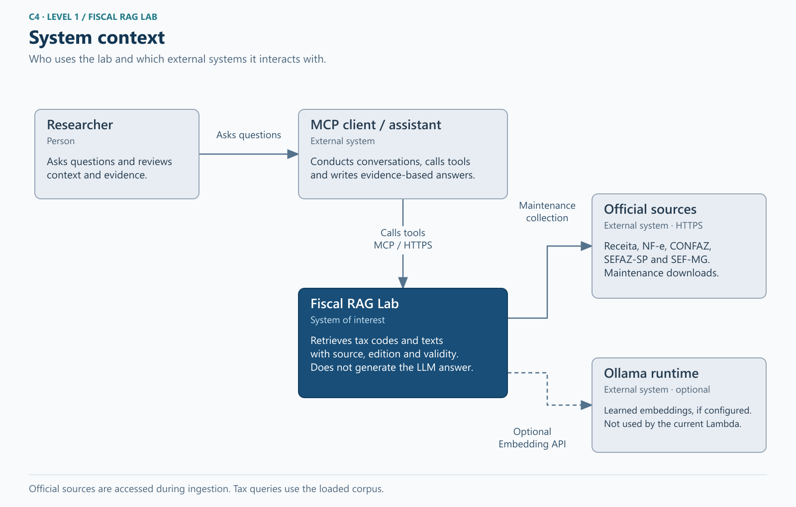
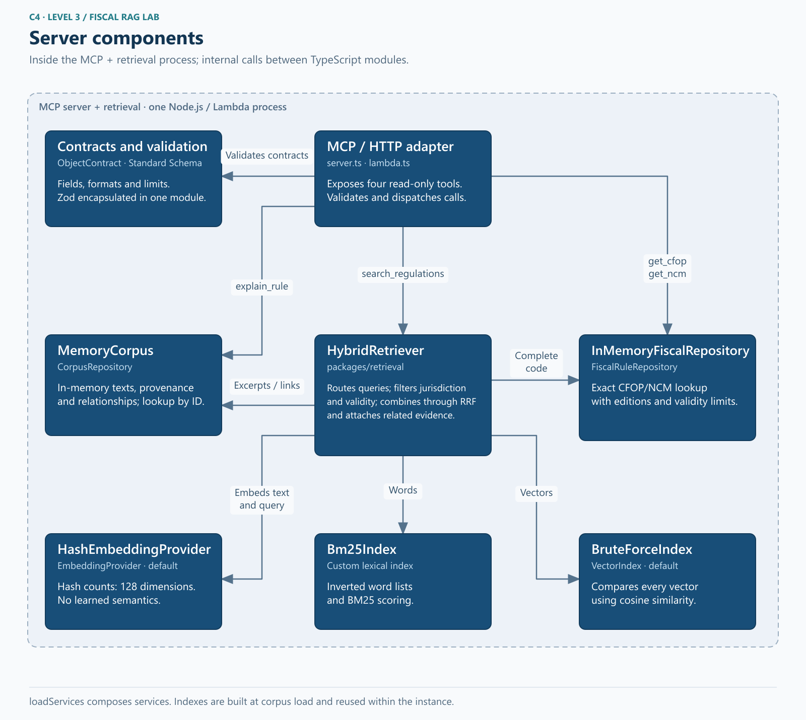
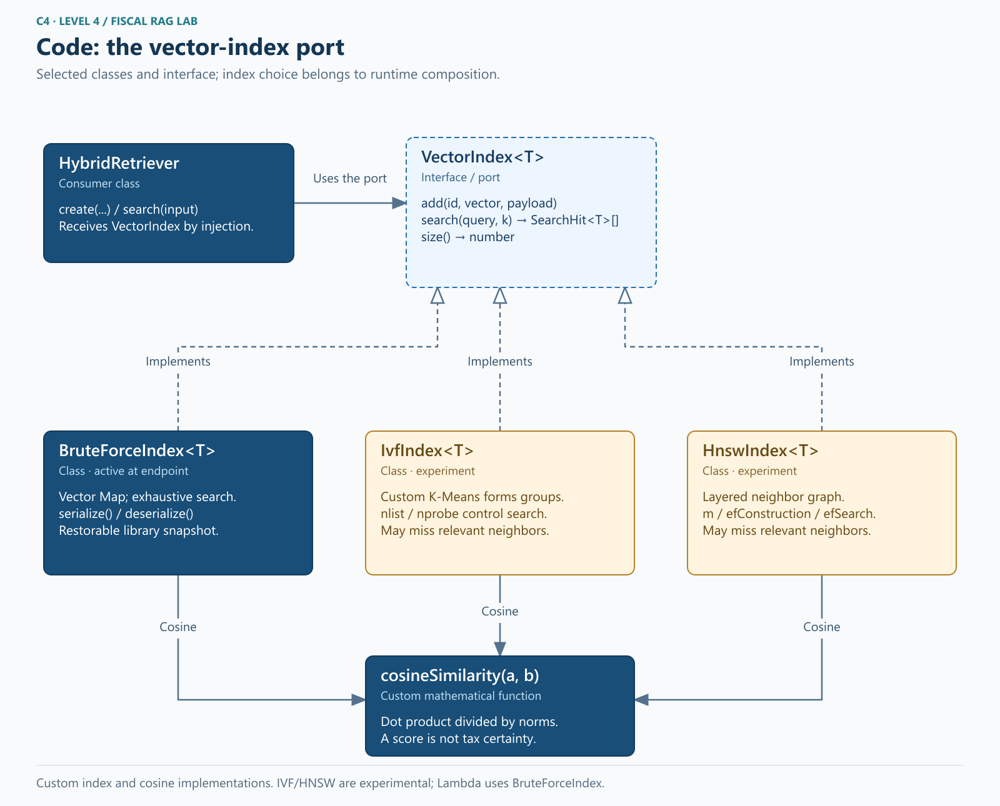

# Fiscal RAG Lab

A Brazilian tax research laboratory with **RAG, custom search algorithms and read-only MCP tools**. The project turns official documents and CFOP/NCM tables into searchable evidence while preserving sources, editions, dates and relationships between excerpts.

The goal is to study and inspect the entire workflow: download a source, extract its content, build indexes, retrieve evidence and deliver it to an assistant. The application implements retrieval; the client LLM writes the answer from the results. The server contains neither a generative LLM nor a complete tax decision engine.

**Status documented on 2026-11-15:** MCP server, ingestion, hybrid search, exact/IVF/HNSW indexes, encapsulated contracts and evaluations are implemented. An [HTTPS demo runs on AWS](https://d2kvl1uo6lcsgz.cloudfront.net), with an official corpus loaded on 2026-11-14. The endpoint uses 128-dimensional lexical hashing and an exact vector index; learned embeddings, IVF/HNSW at the endpoint and LoRA training are not active. Human tax review and complete plugin testing in ChatGPT Work remain pending.

> This is an educational evidence retrieval project. Text similarity and matching codes do not establish tax applicability. The project does not issue NF-e or automatically calculate all taxes on a transaction.

## Navigation

- [What the project provides](#what-the-project-provides)
- [Technologies and responsibilities](#technologies-and-responsibilities)
- [How data flows through the system](#how-data-flows-through-the-system)
- [C4 architecture at four levels](#c4-architecture-at-four-levels)
- [Architectural decisions — ADRs](#architectural-decisions--adrs)
- [MCP tools](#mcp-tools)
- [Corpus and provenance](#corpus-and-provenance)
- [Run locally](#run-locally)
- [Tests and evaluations](#tests-and-evaluations)
- [AWS deployment and plugin](#aws-deployment-and-plugin)
- [Repository structure](#repository-structure)
- [Limitations and next steps](#limitations-and-next-steps)

For a beginner-friendly explanation of vectors, cosine similarity, BM25 and RRF, with calculations and runnable examples, read [README-RAG](README-RAG.md). This README introduces the project and connects its parts to the decisions behind them.

## What the project provides

| Capability | Implementation and scope |
|---|---|
| Verifiable ingestion | Official downloads, SHA-256 snapshots, collection metadata and format-specific parsers. |
| Exact CFOP/NCM lookup | Normalized complete codes, preserved editions and explicit missing, ambiguous or insufficient-evidence results. |
| Document chunking | Legal units with article, exception and same-excerpt links where recognized. |
| Lexical search | Custom BM25 with a word inverted index. |
| Vector search | Cosine similarity, exhaustive search, K-Means/IVF and HNSW implemented in the project. |
| Hybrid search | Complete-code routing, text retrieval and Reciprocal Rank Fusion (RRF). |
| Filtering and attribution | Jurisdiction, known validity intervals, sources and related evidence. Unknown boundaries remain explicit. |
| Assistant integration | Four read-only MCP tools with structured inputs and outputs. |
| Reproducible evaluation | Fixtures, numerical tests, HTTP integration, fixed datasets and results with execution conditions. |

Implementing the indexes instead of delegating search to a turnkey vector database is part of the educational goal: [ADR-0002](docs/adr/0002-manual-vector-index.md). Libraries are still used for transport, parsing and validation, with explicit boundaries.

## Technologies and responsibilities

Versions are declared in [package.json](package.json); complete resolution is pinned in [package-lock.json](package-lock.json). This table describes use in this repository, not a recommendation of the latest versions.

| Technology | Version / configuration | Where and why |
|---|---|---|
| TypeScript | 5.8.3; `strict` mode; ESM/NodeNext modules | Application code, contracts and typed ports. [ADR-0001](docs/adr/0001-modular-monolith.md). |
| Node.js | 22+ for development; Node 22 on Lambda | HTTP runtime, CLIs, file/cryptography APIs and tests. |
| Official MCP SDK | `server` and `client` 2.4.0; `node` adapter 2.1.2 | Negotiation and Streamable HTTP transport without manually implementing the protocol. [ADR-0008](docs/adr/0008-mcp-runtime.md). |
| Project-owned validation classes | `Schema<T>`, `ObjectContract`, `Field` | Readable contracts, inferred types and project-owned errors. [ADR-0011](docs/adr/0011-validation-facade.md). |
| Zod | 4.6.7, encapsulated | Internal validation and JSON Schema engine. An adapter converts our contracts to Standard Schema; consumers do not import Zod. [Guide](packages/validation/README.md). |
| ExcelJS | 4.4.0 | Reads CFOP spreadsheets in the worker. The fiscal parser validates the schema and rejects formulas. [ADR-0006](docs/adr/0006-parsing-and-runtime.md). |
| Cheerio | 1.1.2 | HTML extraction with selectors specific to official sources. [ADR-0010](docs/adr/0010-official-html-ingestion.md). |
| iconv-lite | 0.7.0 | Page decoding, including Windows-1252. [ADR-0010](docs/adr/0010-official-html-ingestion.md). |
| JSON, SHA-256 and in-memory structures | Native Node.js APIs; `Map`, `Float32Array` | Snapshots, corpus, provenance and local indexes. The current deployment has no managed vector database. [ADR-0004](docs/adr/0004-versioned-legal-corpus.md). |
| Hash embeddings | `lexical-fnv1a-v1`, 128 dimensions | Deterministic word control used by the endpoint; not a learned semantic model. [ADR-0007](docs/adr/0007-embedding-adapters.md). |
| Ollama | Optional adapter; no model selected for deployment | HTTP integration through `EmbeddingProvider`, available for learned-embedding experiments. [ADR-0007](docs/adr/0007-embedding-adapters.md). |
| esbuild | 0.28.2; development tool | Bundles the server into `index.mjs` for Lambda. [ADR-0009](docs/adr/0009-aws-demo.md). |
| Sharp | 0.35.5; development tool | Renders SVG assets and diagrams to PNG. Does not participate in tax research. |
| `node:test` and `node:assert` | Built into Node.js | Unit tests, MCP contracts and TypeScript inference validation. |
| GitHub Actions | Versioned workflow | Reproducible installation, tests, architecture boundaries, Lambda build and dependency audit. [CI](.github/workflows/ci.yml). |
| AWS | S3, CloudFront, API Gateway HTTP API, Lambda and CloudWatch Logs | Static pages, HTTPS, MCP execution and operational logs. Infrastructure in CloudFormation. [ADR-0009](docs/adr/0009-aws-demo.md). |
| C4 model | Versioned JSON, Structurizr DSL export, SVG and PNG | Context, container, component and selected code views. [Sources and generation](docs/c4/README.md). |

### Algorithms implemented in the lab

| Algorithm | Role | Current use |
|---|---|---|
| Cosine similarity + exhaustive search | Compares the query against every vector; exact reference for the metric. | Endpoint vector index. |
| BM25 | Combines frequency, word rarity and excerpt length. | Endpoint lexical search. |
| RRF | Combines result positions across searches without adding incompatible scales. | Default hybrid mode. |
| Spherical K-Means + IVF | Groups vectors and probes some groups, trading coverage for fewer comparisons. | Experiments and benchmarks. |
| HNSW | Organizes vectors in a layered neighbor graph. | Experiments and benchmarks. |

Changing the index does not automatically improve the text representation. An approximate index over lexical vectors still searches lexical vectors. Details are in the [RAG guide](README-RAG.md) and [index results](docs/benchmarks/README.md).

## How data flows through the system

1. **Source maintenance:** the worker downloads authorized official editions, stores bytes and metadata, verifies hashes and applies the appropriate parser. Content becomes CFOP/NCM records and chunks with provenance.
2. **Corpus construction:** records and excerpts are assembled in `corpus.json`. Downloads without parsers remain archived rather than becoming searchable evidence.
3. **Server initialization:** `loadServices` reads the corpus, creates in-memory repositories, computes chunk vectors and builds BM25 and vector indexes.
4. **MCP call:** the client sends a tool and its arguments. The adapter validates input and calls services in the same Node.js process.
5. **Retrieval:** complete codes use exact lookup. Text questions use BM25, cosine similarity or both; known filters apply before the final result cutoff.
6. **Document response:** the server returns excerpts, IDs, URLs, editions, dates and warnings. The assistant uses this material to write the answer and identify gaps.

Ingestion is separate from querying. The endpoint does not fetch official pages to complete a question in real time. The answer policy is described in [RAG-only evidence](docs/rag-only.md), and evidence handling in [ADR-0004](docs/adr/0004-versioned-legal-corpus.md).

Lambda reuses services while the same instance stays active. New instances rebuild their indexes. The corpus is bundled with the function; editing a local file does not automatically update deployment.

## C4 architecture at four levels

The project is a **modular monolith with ports and adapters**: MCP/HTTP and providers are external boundaries; domain, corpus and retrieval use project-owned interfaces. The ingestion worker is a separate CLI. Rationale: [ADR-0001](docs/adr/0001-modular-monolith.md), complemented by [ADR-0003](docs/adr/0003-mcp-boundary.md).

The following PNGs are versioned and can be opened at full size. The [shared model](docs/c4/model.json) generates images and the [Structurizr DSL export](docs/c4/workspace.dsl), avoiding independent descriptions for each format. Box positions are stored in the model; rendering code is in [render-c4.ts](scripts/render-c4.ts).

### Level 1 — Context

Shows who uses the lab and the external systems involved. The assistant conducts the conversation; Fiscal RAG Lab retrieves evidence. Ollama appears as an optional integration outside the current Lambda path.

[](docs/c4/images/01-context.png)

### Level 2 — Containers

Shows execution and storage units. **A C4 container does not mean Docker.** The MCP server and retrieval logic run in the same process; the worker, file corpus and static page have separate responsibilities. CloudFront/API Gateway forward requests to the server in the AWS deployment.

[](docs/c4/images/02-containers.png)

### Level 3 — Components

Breaks the server into the MCP adapter, contracts, repositories and retrieval. `HybridRetriever` combines BM25, a vector provider and the exact index while preserving evidence sources. These boxes represent modules in one process, not microservices.

[](docs/c4/images/03-components.png)

### Level 4 — Code

A selected view of vector-index classes. `HybridRetriever` depends on the `VectorIndex<T>` port; `BruteForceIndex`, `IvfIndex` and `HnswIndex` implement the same contract. This view exposes the decision in [ADR-0002](docs/adr/0002-manual-vector-index.md) without trying to reproduce every class in the repository.

[](docs/c4/images/04-code.png)

To regenerate all formats with dependencies already installed:

```sh
npm run docs:c4
```

This runs locally without sending the model to diagram services. The DSL export covers levels 1–3; level 4 is the class view produced from the same model in SVG/PNG. Editing instructions and limitations are in [docs/c4/README.md](docs/c4/README.md).

## Architectural decisions — ADRs

An ADR records context, a decision and its consequences. The links make the reasoning inspectable; they do not certify the system's tax correctness. Some records preserve the initial decision state: corpus evolution and refinements are described in the current guides.

| Decision | Recorded rationale |
|---|---|
| [0001 — Modular monolith and ports/adapters](docs/adr/0001-modular-monolith.md) | Reduce operational complexity and keep search/domain independent of transport and vendors. |
| [0002 — Custom vector indexes](docs/adr/0002-manual-vector-index.md) | Study algorithms and measure approximations against an exact reference. |
| [0003 — MCP as a read-only adapter](docs/adr/0003-mcp-boundary.md) | Share the backend across clients without coupling the domain to a chatbot. |
| [0004 — Versioned legal evidence](docs/adr/0004-versioned-legal-corpus.md) | Preserve provenance, editions, structure and temporal limits. |
| [0005 — Fine-tuning after retrieval evaluation](docs/adr/0005-fine-tuning-strategy.md) | Separate gains from search, instructions and training; avoid treating memorization as legal updates. |
| [0006 — Parsing libraries in adapters](docs/adr/0006-parsing-and-runtime.md) | Use a maintained XLSX parser without delegating fiscal logic or search algorithms. |
| [0007 — Embeddings through a project-owned port](docs/adr/0007-embedding-adapters.md) | Swap providers without changing retrieval and distinguish lexical controls from learned models. |
| [0008 — Official MCP SDK](docs/adr/0008-mcp-runtime.md) | Delegate negotiation and transport to the SDK with testable integration. |
| [0009 — AWS demo](docs/adr/0009-aws-demo.md) | Use S3/CloudFront for files and API Gateway/Lambda for processing. |
| [0010 — Official HTML extraction](docs/adr/0010-official-html-ingestion.md) | Specific selectors/encoding, snapshot preservation and explicit exclusion of corrupted content. |
| [0011 — Encapsulated validation](docs/adr/0011-validation-facade.md) | Project-owned contract classes, private Zod and Standard Schema integration. |

## MCP tools

| Tool | Main input | Returns |
|---|---|---|
| `get_cfop` | Complete code; optional date. | Exact records, editions, provenance, temporal status and missing context. |
| `get_ncm` | Complete NCM; optional date. | Available record and notes; does not automatically classify a product. |
| `search_regulations` | Text, date, jurisdiction, `topK` and search mode. | Ranked and related evidence; complete codes may follow the exact route. |
| `explain_rule` | Evidence ID; optional date. | Existing text and relationships, without tool-generated tax advice. |

All tools are read-only. Contracts reject extra fields, restrict formats and validate output. Each response includes `structuredContent` and its JSON text representation. See the [documented contracts](docs/mcp-contracts.md), [executable declarations](apps/mcp-server/src/contracts.ts) and [validation facade](packages/validation/README.md).

The default text search mode is hybrid. `jurisdiction: 'MG'` allows MG and BR sources; SP works the same way. Dates incompatible with known intervals are excluded; unknown boundaries remain marked `unknown`. Ranking does not automatically resolve tax regimes, purchase purpose or exception applicability.

## Corpus and provenance

The official load recorded on **2026-11-14** prioritized national sources, then São Paulo and Minas Gerais. Other states are outside this selection.

| Load report metric | Count |
|---|---:|
| Downloaded source entries | 71, representing 70 distinct URLs |
| Indexed source entries | 66 |
| Complete NCM records | 10,516 |
| CFOP records | 619 |
| National evidence chunks | 13,604 |
| SP evidence chunks | 8,504 |
| MG evidence chunks | 11,388 |
| Total evidence chunks | 33,496 |

Evidence items are chunks and textual code representations, not necessarily independent documents. Counts and URLs are in the [per-source report](docs/data/official-corpus.json); content, archive-only files and exclusions are described in the [official ingestion guide](docs/official-ingestion.md).

Each evidence item preserves identifiers, text, authority, jurisdiction, official URL, edition, collection time, checksum and known dates. Unknown dates are `null`; downloading a consolidation today does not establish each provision's validity on a requested date.

Downloaded bytes and the corpus live in `.data/`, outside Git. The repository contains the code, catalog and reports needed to reproduce ingestion. Complete documents may only be redistributed after applicable terms are reviewed. This separation follows [ADR-0004](docs/adr/0004-versioned-legal-corpus.md).

Repository documentation, comments, prompts and interface messages are in English. Original Portuguese evidence, official names/schema keys and language-specific retrieval fixtures are preserved so translations do not replace source material or invalidate evaluations.

## Run locally

Requirements: **Node.js 22+ and npm**. No vector database installation or LLM configuration is needed to run the synthetic demo.

### Install and verify

From the repository root:

```sh
npm ci
npm test
npm run check:boundaries
```

### Start with synthetic data

```sh
npm start -- --demo
```

The server listens at `http://127.0.0.1:3000/mcp`. Demo data consists of fixtures with no fiscal value. In another terminal, run an independent tool-call demonstration:

```sh
npm run demo:mcp
```

This command starts its own temporary server, calls tools with the official client, writes `.data/demo-transcript.json` and exits. It does not require an assistant account and does not constitute testing inside ChatGPT Work.

### Prepare and use the official corpus

Ingestion is an explicit maintenance operation that accesses configured official sources:

```sh
npm run ingest:official
npm start
```

Without `--demo`, the default local path is `.data/corpus.json`; build the corpus if the file does not exist. To reprocess existing snapshots, use `npm run ingest:official -- --reuse`. This is not a new source consultation. For manifest-based reconstruction, formats and requirements, see [official ingestion](docs/official-ingestion.md) and the [worker](apps/ingestion-worker/README.md).

### Local configuration

| Variable | Default / purpose |
|---|---|
| `MCP_CORPUS` | Corpus path; usually `.data/corpus.json`. |
| `MCP_HOST` / `MCP_PORT` | `127.0.0.1` / `3000`. |
| `EMBEDDING_PROVIDER` | `hash`; `ollama` requires an available runtime and model. |
| `EMBEDDING_MODEL` | `lexical-fnv1a-v1` for the hash control. |
| `EMBEDDING_DIMENSIONS` | `128` for the hash control; must match the selected model. |
| `OLLAMA_URL` | `http://127.0.0.1:11434` for the optional local adapter. |

These embedding options are read by the local entry point. Lambda uses the default composition and does not start using Ollama merely because these variables are set. Do not mix models or dimensions between documents and queries. Details are in the [server guide](apps/mcp-server/README.md).

## Tests and evaluations

The project distinguishes three kinds of verification:

| Verification | Demonstrates | Does not demonstrate |
|---|---|---|
| Automated tests | Calculations, invariants, parsing, limits, types and transport contracts. | Tax correctness of every possible answer. |
| Vector benchmark | Index recall and cost against exact search on fixed data. | Guaranteed performance on another corpus or scale. |
| Document evaluation | Evidence retrieval and defined criteria on fixed cases. | General LLM generation quality or human tax approval. |

The local suite passed **50 tests** during the validation refactor, including MCP integration under earlier/modern negotiations and the Lambda adapter. [CI](.github/workflows/ci.yml) runs on every push and pull request on any branch, and can be started manually from Actions. It uses Node.js 22 and runs lockfile installation, tests, boundary checks, explicit fixture packaging and a runtime dependency audit.

The workflow has read-only permissions, Actions pinned by commit and a 15-minute timeout. A new run for the same branch or pull request cancels the previous one. Tests use public fixtures and need neither AWS credentials nor the local production corpus.

Reproduction commands:

```sh
npm run benchmark:vectors -- .data/vector-benchmark.json
npm run eval:retrieval -- .data/retrieval-results.json
npm run eval:initial
```

The last command queries the remote MCP to verify the [initial document scenario](docs/initial-scenario.md). It is neither tax certification nor a test of an assistant's final answer.

The [vector results](docs/benchmarks/README.md) publish parameters, data and limitations: in the 1,000-vector trial, HNSW was slower than exact search; IVF saved time at the cost of recall. The [retrieval evaluation](docs/benchmarks/retrieval.md) uses 40 cases and a small editorial corpus, separate from the 33,496 official chunks; it must not be presented as an evaluation of the entire current dataset.

LoRA datasets and an experiment manifest are prepared, but training and comparison of baseline, RAG and fine-tuned RAG remain open under [ADR-0005](docs/adr/0005-fine-tuning-strategy.md).

## AWS deployment and plugin

The [MCP endpoint](https://d2kvl1uo6lcsgz.cloudfront.net/mcp) is served through:

```text
MCP client → CloudFront → API Gateway HTTP API → Node.js Lambda
                  └── static page and policy → private S3
```

S3 does not execute search. Lambda receives `index.mjs` and `corpus.json`, loads data and maintains in-memory indexes. The documented configuration uses 1,024 MiB and a 28-second timeout, with gateway limits and sanitized operational logs. Infrastructure: [CloudFormation template](deploy/aws/template.json); rationale: [ADR-0009](docs/adr/0009-aws-demo.md); procedures: [AWS guide](deploy/aws/README.md).

`npm run build:lambda` generates the local package with the populated corpus; it does not deploy. CI explicitly uses `--demo` with fixtures. Code, local documents and the published service may be at different revisions until a deliberate deployment. The [official-load smoke report](docs/deployment/aws-official-smoke.json) records remote verification at that corpus's publication.

The account plugin remains **private and free**, without public submission. Private plugin distribution does not authenticate the HTTPS endpoint: the demo endpoint serves public documentation and must not receive a confidential corpus. The deployment origin secret restricts the path to Lambda; it does not identify end users.

The portable package is under [plugins/fiscal-rag](plugins/fiscal-rag/README.md). Full Work testing, video and submission remain pending in the [review materials](docs/plugin-review.md). RAG-only evidence instructions guide the assistant but do not erase its prior knowledge or independently prove that every sentence is supported: [policy limitations](docs/rag-only.md).

## Repository structure

| Path | Responsibility |
|---|---|
| [apps/mcp-server](apps/mcp-server/README.md) | Tools, contracts, HTTP/Lambda and service composition. |
| [apps/ingestion-worker](apps/ingestion-worker/README.md) | Downloads, snapshots and official parsers. |
| [packages/vector-core](packages/vector-core/src/vector-index.ts) | Index port, cosine similarity, exact search, K-Means, IVF and HNSW. |
| [packages/retrieval](packages/retrieval/README.md) | Chunking, BM25, routing, filters and RRF. |
| [packages/fiscal-domain](packages/fiscal-domain/README.md) | Exact lookup and code editions. |
| [packages/corpus](packages/corpus/src/evidence.ts) | Evidence, provenance and document relationships. |
| [packages/application](packages/application/src/corpus-file.ts) | Corpus file contract. |
| [packages/adapters](packages/adapters/src/hash-embedding.ts) | Hash and Ollama vector providers. |
| [packages/validation](packages/validation/README.md) | Schema classes and validation encapsulation. |
| [packages/evaluation](packages/evaluation/src/dataset.ts) | Datasets, metrics and behavior supervision. |
| [config/official-sources.json](config/official-sources.json) | Official ingestion catalog. |
| [scripts](scripts) | Operations, evaluations, packaging and documentation generation. |
| [test](test) | Tests and fixtures; synthetic examples are identified. |
| [eval](eval) and [experiments](experiments) | Fixed cases and experiment preparation. |
| [deploy/aws](deploy/aws/README.md) | Demo infrastructure and operations. |
| [docs/adr](docs/adr/README.md) and [docs/c4](docs/c4/README.md) | Decisions and architectural views. |
| [tasks.md](tasks.md) and [TODO.md](TODO.md) | Deliverables, coherent commits, pending work and limitations. |

## Limitations and next steps

- Improve ranking for the initial scenario: broad queries may prioritize documents with similar vocabulary but a different transaction.
- Separate historical wording and expand provision-level validity; download time does not establish legal validity.
- Implement parsers for downloaded auxiliary files and add individual federal, SP and MG acts as needed.
- Evaluate learned embeddings with recorded model, version and conditions before changing the published default.
- Measure memory and cost in isolated processes and review candidates/filters for larger corpora.
- Complete human tax review and evaluation of assistant behavior with the evidence.

Sources are not updated automatically, and conversations are not used for training. Detailed pending work is in [TODO.md](TODO.md); implementation scopes are in [tasks.md](tasks.md).

## Contributing and license

The [contributor instructions](AGENTS.md) require one coherent task per commit, domain/adapter boundaries, numerical algorithm and MCP contract tests, and preserved provenance. Credentials, personal contact details, documents without redistribution review and ignored operational data must not enter Git.

Code is licensed under **MIT**; see [LICENSE](LICENSE). Third-party documents and materials remain subject to their own terms.
