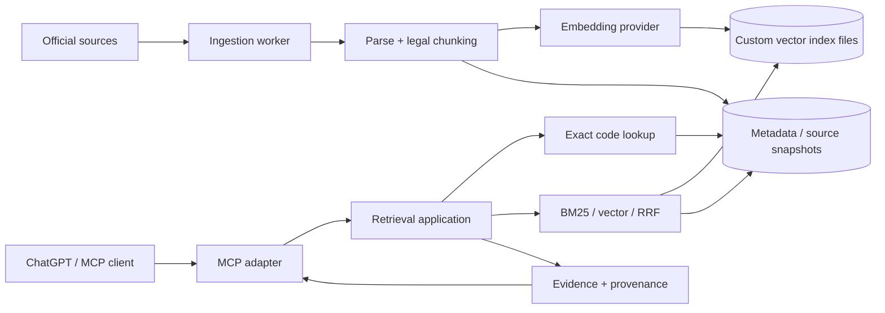

# Architecture overview (proposal)

## Intent and non-goals

Create an educational, open-source proof of concept in which custom retrieval algorithms, index behavior, MCP tool use, and agent behavior can be tested independently. Not a full ERP, invoice emitter or tax-compliance system.

## C4 model

The canonical C4 source is [`c4/workspace.dsl`](c4/workspace.dsl). Render with Structurizr Lite or the Structurizr CLI. The model defines **System Context**, **Containers** and **Components** for the retrieval runtime.

## Logical data flow

## Key interfaces

- `EmbeddingProvider`: text input -> fixed-dimension float vector; provider can be local or external.
- `VectorIndex`: add/search vectors, version-specific serialization; implementations: brute-force, IVF, HNSW.
- `CorpusRepository`: documents, legal hierarchy, source URL, checksum, validity intervals.
- `Retriever`: ranked evidence from exact, lexical and semantic routes.
- `FiscalRuleRepository`: deterministic CFOP/NCM data lookup.
- `McpToolHandlers`: translate protocol requests into application use cases.

## Temporal and jurisdiction rules

Every normative source must carry at minimum source id, URL, fetchedAt, publication date (if available), validity range (if known), authority, jurisdiction, and checksum. Unknown dates must be represented as unknown; never silently assume 'currently valid'.

## Security baseline

Read-only MCP tools, input validation, no remote code execution, request throttling, sanitized error messages, no raw PII logs, no secret material in results. Treat prompt injection in government PDFs or user-supplied files as untrusted content. Plugin reviews may require public documentation, privacy terms and a stable HTTPS endpoint.
