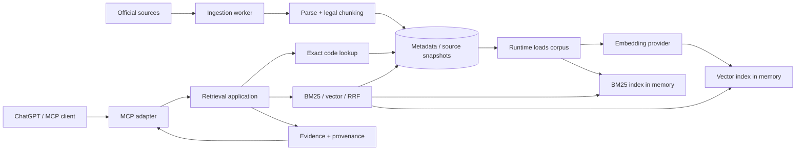

# Architecture overview

## Intent and non-goals

Create an educational, open-source proof of concept in which custom retrieval algorithms, index behavior, MCP tool use, and agent behavior can be tested independently. Not a full ERP, invoice emitter or tax-compliance system.

## C4 model

The shared C4 source is [`c4/model.json`](c4/model.json). Run `npm run docs:c4` to generate PNG/SVG views and the [`Structurizr DSL export`](c4/workspace.dsl). The views cover **System Context**, **Containers**, **Components**, and a focused **Code** view of vector-index classes. The DSL export covers levels 1–3. See [generation and interpretation](c4/README.md) and the embedded images in the [main README](../README.md#c4-architecture-at-four-levels).

MCP and retrieval run in one Node.js process (locally or in Lambda); they are modules, not separate network services. Ingestion writes text and metadata to the corpus. Embeddings and both search indexes are built when the server loads that corpus. The deployed composition uses lexical hashing and exact cosine search; IVF/HNSW and learned embeddings remain separate experiments. The updated diagrams correct the initial proposed process split to reflect this implementation.

## Logical data flow

## Key interfaces

- `EmbeddingProvider`: text input -> fixed-dimension float vector; provider can be local or external.
- `VectorIndex`: add/search vectors and report size; implementations: brute-force, IVF, HNSW. Snapshot serialization is specific to the exact index, not part of the shared port or the deployed loading path.
- `CorpusRepository`: documents, legal hierarchy, source URL, checksum, validity intervals.
- `HybridRetriever`: ranked evidence from exact-code, lexical and vector routes. The published hash vectors are lexical, not learned semantic representations.
- `FiscalRuleRepository`: deterministic CFOP/NCM data lookup.
- MCP handlers in `server.ts`: translate protocol requests into application use cases.
- `Schema<T>` / `ObjectContract`: project-owned validation, connected to MCP through the Standard Schema adapter; Zod stays private to the validation module.

## Temporal and jurisdiction rules

Every normative source must carry at minimum source id, URL, fetchedAt, publication date (if available), validity range (if known), authority, jurisdiction, and checksum. Unknown dates must be represented as unknown; never silently assume 'currently valid'.

## Security baseline

Read-only MCP tools, input validation, no remote code execution, request throttling, sanitized error messages, no raw PII logs, no secret material in results. Treat prompt injection in government PDFs or user-supplied files as untrusted content. Plugin reviews may require public documentation, privacy terms and a stable HTTPS endpoint.
